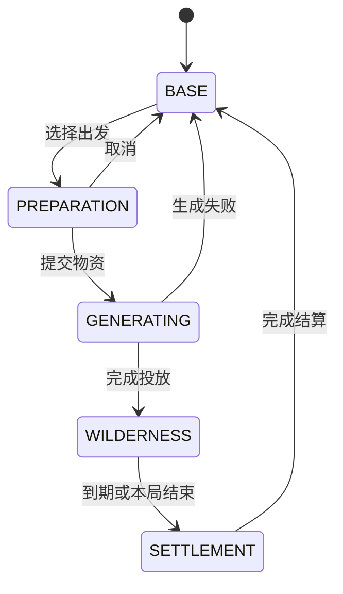
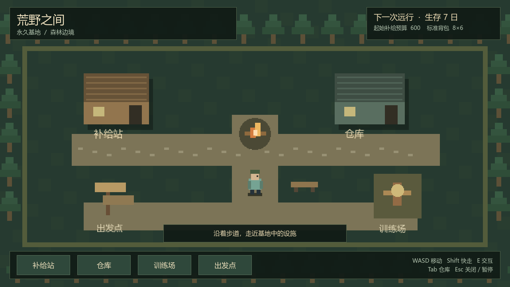
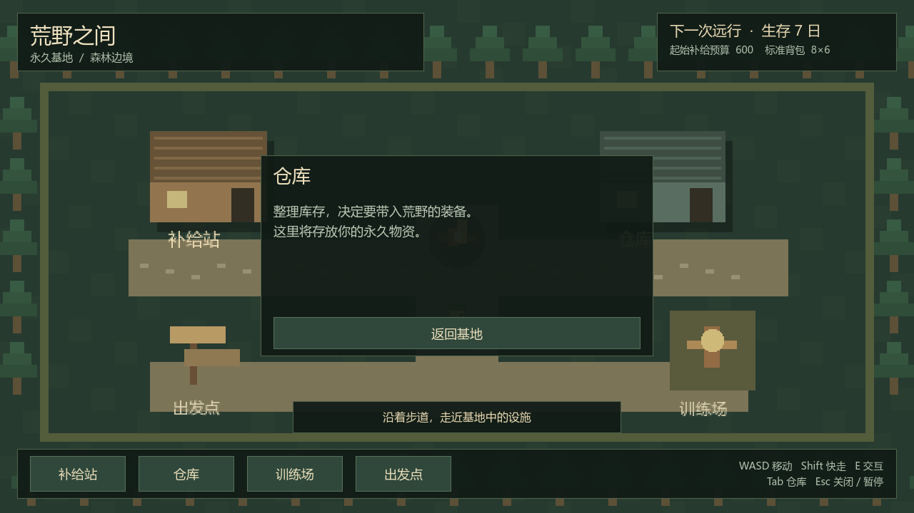

# P0 实施与验证报告

日期：2026-10-12（Asia/Shanghai）。设计基线：0.2。阶段状态：P0 完成。

## 1. 当前交付

- 可启动的永久基地：代码生成像素占位画面、四个入口、人物移动、边界 / 建筑碰撞、靠近提示、E 键交互、鼠标按钮和返回面板。
- 世界以 640×360 子视口渲染、最近邻放大，UI 使用 1280×720；中文使用系统字体，不分发 Windows 字体文件。
- 配置 Resource 与实例状态分离，基础时间、营养 / 饮水 / 体力、网格 / 容量 / 负重和联机人数参数已录入。
- 稳定玩家身份、玩家状态快照、主流程状态机、本地会话命令校验 / 重发保护、单机 / 合作暂停策略。
- 正常游戏保存身份到 `user://profile_identity.cfg`；测试路径注入工作区，验证不修改正式身份。
- 当前画面资金是配置中的「起始补给预算」，不是已经实现的可交易账户；商店、仓库、技能、出发点为查看入口。

本阶段没有实现货币交易、网格物品、随机荒野、身体时间消耗、存档整局恢复或实际网络连接。身体数值仅为初始状态；合作验证仅测试暂停策略，不能称为双人联机测试。

## 2. 实际环境

| 项目 | 实测 / 配置 |
| --- | --- |
| 编辑器完整版本 | `4.7.2.stable.official.ed1daf0bf`，已执行 `--version` 核实 |
| 来源 | 已有 `D:/Download/Godot_v4.7.2-stable_win64.exe.zip`，解压到工作区 `.tools/godot/` |
| 渲染器 | 工程配置 `gl_compatibility`，真实窗口验证为 Compatibility |
| 图形 API / 设备 | OpenGL 3.3.0，Intel Iris Xe Graphics；来自实际渲染启动日志 |
| 主场景 | `res://scenes/main.tscn` |
| 根 UI / 世界 | 1280×720 / 640×360 子视口，固定比例 |
| 工程缓存 | `.godot/`；本地引擎 `.tools/` 已忽略，并有 `.gdignore` 避免资源扫描 |
| 额外安装 / 网络服务 | 未下载安装额外引擎，未连接服务器或开启联机监听 |

本地编辑器启用 `_sc_` 自包含模式，把编辑器设置放在引擎旁的 `editor_data/`，参考 [Godot 数据路径文档](https://docs.godotengine.org/en/stable/tutorials/io/data_paths.html)。游戏正式身份仍走 `user://`；验证通过显式路径注入隔离数据。

验证环境不允许写系统用户目录，首次编辑器导入出现内置 profiler 用户目录提示，图形预览出现无法创建可选 shader cache 的提示。两者未阻止资源导入或图形运行；最终游戏 headless 启动及 34 项检查日志没有脚本错误。未为这些可选目录申请系统写入权限，也未关闭用户系统保护。

## 3. 模块与契约

| 文件 / 模块 | 已实现职责 |
| --- | --- |
| `data/game_config.tres` / `WildGameConfig` | 运行时基础配置与有效性检查；后续配置改此 Resource，不改实例 |
| `WildStableId` | 随机稳定 ID，无 peer ID / NodePath 依赖 |
| `WildPlayerState` | 按玩家 ID 的独立身体状态，快照复制嵌套字典 |
| `WildRunFlow` | 允许的阶段转换，非法请求不改变阶段 |
| `WildGameCommand` / `WildOperationResult` | 意图、唯一请求 ID、错误码和结果副本 |
| `WildLocalSession` | 注册 / 查询玩家、入口命令、身份 / 请求冲突检查、暂停通知；只处理 P0 命令 |
| `WildSessionPolicy` | 单机菜单 / 失焦暂停，合作个人操作不暂停世界 |
| `WildProfileIdentityStore` | 可注入路径的身份读取 / 创建，拒绝坏版本而不覆盖文件 |
| `WildBaseWorld` / `WildBaseExplorer` | 图形、碰撞、当前本地玩家输入与交互意图，角色视图用 ID 查找 |
| `WildMain` | 组合依赖、连接意图 / 结果、显示 HUD / 面板，UI 不改业务属性 |

没有添加万能 AutoLoad 或真实 Host / Client RPC。以后房主会话复用领域规则；当前本地面板命令不应机械改成所有玩家共享的远程 UI 状态。

后续模块的固定接口边界：库存接收容器 / 物品 ID、放置 / 转移参数和预期版本，返回操作结果；动作接收操作者、动作 / 配方 ID、资源选择，协调各领域规则；身体模拟接收玩家状态、游戏时间增量与活动强度，不读取 UI 或文件；网络会话负责实际连接身份映射与异步结果，不自行实现第二套算法。

## 4. 主流程状态图

状态机规则已实现，当前可运行的世界只包括 BASE；其余场景与实际阶段转换由 P1–P3 接入。BASE 不能直接跳到 WILDERNESS。

## 5. 验证结果

| 验证 | 结果 |
| --- | --- |
| 配置读取、错误阈值拒绝、共享配置不污染 | 通过 |
| 身份创建 / 读取同 ID、坏版本不覆盖 | 通过 |
| 非法流程转换、生成失败回基地 | 通过 |
| 未知操作者 / 入口拒绝、重复玩家拒绝 | 通过 |
| 快照隔离、请求冲突拒绝、重发结果不被调用者污染 | 通过 |
| 单机菜单暂停、合作策略不暂停 | 通过，属于策略单元验证 |
| 真实主场景、移动、建筑碰撞、范围提示、E 键开入口、暂停不移动 / 关闭恢复 | 通过 |
| 总计 | 34 项通过，0 项失败，退出码 0 |
| 图形验证 | 基地与仓库面板 PNG 成功生成并人工查看，中文正常、按钮与文本无截断 |

脚本：`tests/p0_checks.gd`，复现入口：`tools/verify_p0.ps1`。工具核对退出码、完成标记及脚本错误，不能只凭引擎退出码判定通过。Godot 命令行用法参考 [官方文档](https://docs.godotengine.org/en/stable/tutorials/editor/command_line_tutorial.html)。

预览为真实游戏渲染输出：

## 6. 下一阶段

按 [执行计划](02-execution-plan.md) 开始 P1：先完成网格库存规则、重量 / 体积统计、旋转 / 堆叠 / 转移和失败回滚，再接仓库 UI、商店货币、准备装载与档案持久化。保留本地 / 房主会话边界，P3.5 才实现实际双人连接。
