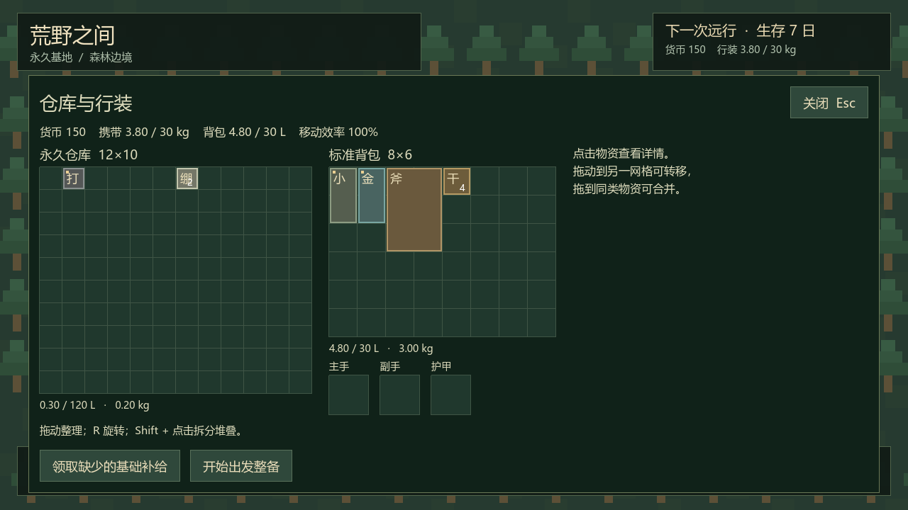
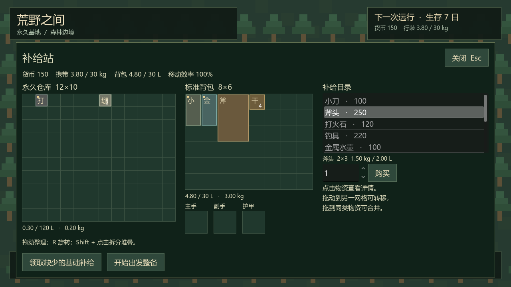

# P1 实施与验证报告

日期：2026-10-12（Asia/Shanghai）。设计基线：0.2。阶段状态：P1 完成。

## 1. 当前交付

- 25 种静态物品定义，实例独立记录稳定 ID、数量、耐久、保鲜时长、水量和免费补给标记；其中 11 种可购买。
- 永久仓库 12×10 / 120 L、背包 8×6 / 30 L，以及主手、副手、护甲槽。装备计入负重、不占背包内部体积；背包空重计入总负重。
- 网格拖放、90° 旋转、拆分、合并和跨容器转移；同时检查占格、体积、30 kg 硬上限、容器类别、归属和预期版本。
- 首次建档 600 货币，购买先检查空间与资金；仓库物资按单价 40% 向下取整出售。免费小刀 / 打火石 / 空水壶不可出售，检查所有归属容器后只补缺失免费实例。
- 基地、准备、占位荒野三段实际流程，生成检查失败或取消时恢复准备前物资与布局；物品只存在于一个当前容器。
- JSON 基地档案、关键操作事务收据、任务 ID、临时文件替换和上一份备份。存盘失败时不更新当前状态，重复请求不会重复扣款或转移。

当前荒野是固定占位场景，可以移动、查看随身库存和返回基地。返回恢复整备前行装，不发奖励。真实随机地图为 P2，时间 / 身体消耗与结算为 P3；饮水、水转移、腐坏推进、技能学习和实际联机仍按后续阶段实现。18 kg 软负重的移动效率已计算并展示，荒野动作与体力惩罚在 P3 接入。

## 2. 操作与存档

用 Godot 4.7.2 打开 `project.godot`，按 F5 运行。

1. 在补给站选择商品、数量后购买；商品进入永久仓库。
2. 打开仓库，拖物品到背包或装备槽；按 R 旋转，Shift + 点击堆叠后选择部分数量并拖放。拖到同类堆叠上合并。
3. 点击「开始出发整备」，调整要携带的物资；没有 5 件上限，仓库剩余物资留在基地。
4. 点击「取消整备」恢复原行装，或「确认出发」进入占位荒野。点击「返回基地」恢复整备前物资。

菜单暂停单机移动，关闭后继续。准备过程中关闭面板不会取消整备，重新打开可继续；重启也恢复当前阶段和物资。占位荒野禁止整理库存，避免将基地仓库作为远程库存使用；荒野库存操作随 P2 / P3 扩展。

正式路径为 `user://profile_identity.cfg` 和 `user://base_state.json`，后者包含五个容器、货币、请求收据、当前阶段及任务准备快照。格式版本为 1。读档检查玩家 ID、版本、整数范围、重复实例、布局和容量；损坏主档尝试 `.bak`，明确的其他玩家或未知版本档案拒绝加载和覆盖。

验证使用独立的 `res://.godot/verification/` 档案；没有消费正式玩家的货币或修改正式物资。

## 3. 模块职责

| 层 / 文件 | 职责 |
| --- | --- |
| `data/item_catalog.tres`、`WildItemDefinition` / `WildItemCatalog` | 静态规格与稳定定义 ID；不持有某个玩家实例 |
| `WildItemInstance` / `WildInventoryContainer` / `WildBaseState` | 实例、布局、容器版本、账户、阶段及准备前快照 |
| `WildInventoryRules` / `WildDataValidation` | 无文件 / UI 依赖的几何、容量、负重、权限、数量与转移规则 |
| `WildBaseService` | 在状态副本上执行业务，存盘成功后提交；生成检查与持久化通过 Callable 注入 |
| `WildLocalSession` | 按玩家 ID 查找服务，接受 UI 命令、返回快照、协调流程和暂停 |
| `WildBaseStateCodec` / `WildBaseStateStore` | 校验档案、编码实例、临时文件提交与备份恢复 |
| `WildBasePanel` / `WildInventoryGrid` / `WildInventoryDragPreview` | 只读快照、显示校验结果、提交购买 / 拖放意图 |
| `WildMain` / `WildWildernessPlaceholder` | 显式组合依赖、持有适配器生命周期、切换世界与输入 |

公开接口、模块职责和关键事务边界有说明注释。拖放预览与正式提交使用同一规则；界面在拖拽开始时不移除物资，失败或取消无需补回。请求收据与物资 / 货币在同一快照内保存。容器版本在撤销后继续增长，旧界面意图不会误命中新状态。

私人 / 公共容器规则已做本地领域验证，但目前只提供个人基地容器；未建立网络监听、Host / Client RPC 或跨机器存档协议。这些在 P3.5 和 P6.5 实现。

## 4. 验证结果

环境沿用 [P0 报告](07-p0-implementation.md)：`4.7.2.stable.official.ed1daf0bf`、Compatibility、OpenGL 3.3 / Intel Iris Xe Graphics。

| 检查 | 结果 |
| --- | --- |
| 网格旋转、越界、重叠、体积、重量、装备类别、水重量与固定外部体积 | 通过 |
| 拆分 / 合并守恒、自身堆叠拒绝、容量失败不转移 | 通过 |
| 私人 / 公共容器权限、旧版本、非法数量 / 小数 / 大整数拒绝 | 通过 |
| 购买、出售、资金不足、满仓不扣钱、免费补给不出售 / 不重复 | 通过 |
| 重发去重、重启收据恢复、同 ID 不同请求拒绝、保存失败可重试 | 通过 |
| 实际文件保存 / 备份、坏档恢复、未知版本和其他玩家保护 | 通过 |
| 超过 5 件出发、取消精确恢复、投放失败回滚并保存、占位阶段恢复 / 返回 | 通过 |
| 真实主场景购买按钮、拖放 / R 旋转 / 部分拖拽 / 取消、场景切换与移动恢复 | 通过 |
| P1 总计 | **98 项通过，0 项失败，退出码 0** |
| P0 回归 | **34 项通过，0 项失败，退出码 0** |
| 实际图形检查 | 仓库与补给站 PNG 已查看，中文、网格、数量、按钮与统计正常 |

复现入口：`tools/verify_p1.ps1`、`tools/verify_p0.ps1`。P1 工具刷新全局类缓存、核对脚本错误和完成标记。受工作区写入限制，编辑器内置 profiler 和图形可选 shader cache 仍有用户目录提示；资源导入、测试和截图成功，无脚本错误。

以下为游戏实际渲染，演示档案独立于正式档案。示例余额 150，背包 4.80 L，总携带重量 3.80 kg。

## 5. 下一阶段

P2 将用随机地图替换占位荒野：有限地图模型、种子与分层地形、连通性、安全出生点、资源分布、移动 / 相机 / 交互范围、有限重试与安全模板，以及完整地图档案。生成成功后提交本局，失败仍使用 P1 的事务回滚边界。
