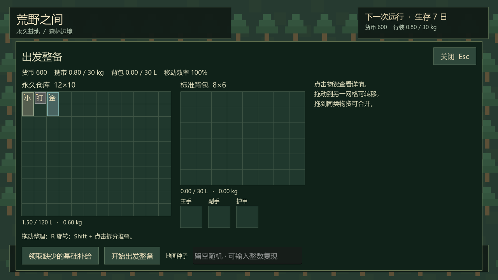
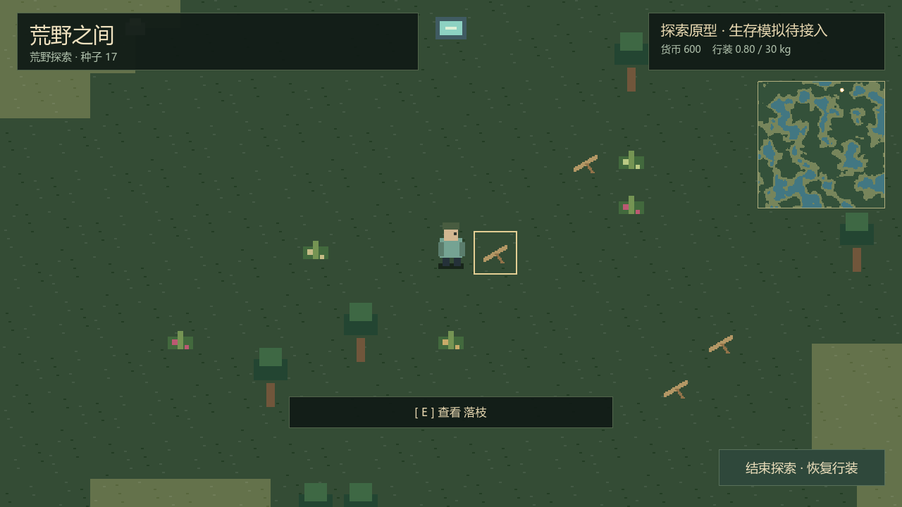
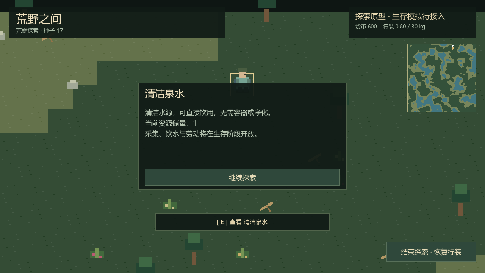

# P2 实施与验证报告

日期：2026-10-12（Asia/Shanghai）。设计基线：0.2。阶段状态：P2 完成。

## 1. 当前交付与范围

- 128×128 有限世界，32 px / 格；连续噪声按分位数生成森林 / 草地 / 水域，控制约 50 / 30 / 20% 的面积比例。
- 四邻接连通与最短路径校验，至少 80% 陆地属于出生点所在连通区；随机出生在可离开的陆地。
- 共 519 个资源点：树 180、石 100、浆果 40、根茎 40、纤维 60、草药 24、落枝 60、鱼点 12、清洁泉水 3。鱼点在可达岸边，资源不占水格、不阻塞通行。
- 出生到食物 / 落枝 / 泉水的最短通行路径分别不超过 8 / 10 / 12 格；保证 3 个食物点、两类食物都有、4 个落枝和至少一处清洁泉水。无需容器或永久技能才能接触水源。
- 最多尝试 5 次；失败使用固定安全模板，模板仍经同一资源 / 安全校验。所有生成方式失败或保存失败时不提交运行世界。
- 按身份驱动角色移动、足部碰撞检查、岸边 / 世界边界限制、相机跟随、地图概览、附近对象高亮与 E 键详情。
- 存档包含完整初始 / 当前地形与资源、种子、生成器版本、独立 RNG 状态、角色位置与资源版本。加载直接恢复快照，不靠种子重建。

P2 是探索原型。资源详情已接入，实际采摘、伐木、饮水、动作计时、资源再生、身体消耗和胜负结算在 P3 及之后实现。危险动物还没有生成；出生保护半径 / 禁入时段在 P6 动物逻辑中落实。当前「结束探索」恢复出发前行装，不发奖励。

## 2. 操作与保存

1. F5 运行主场景。在基地打开出发整备或仓库，输入种子（留空随机）。合法范围为 `0–9223372036854775807`，十进制字符串，无前导零。
2. 开始整备、整理随身物资、确认出发。种子在开始整备时锁定，取消后可重新选择。
3. WASD 移动、Shift 快走、E 查看附近资源、Tab 整理背包 / 装备；水域不能通行，菜单暂停单机。
4. 右上地图白点为角色，金点为出生点。该原型显示完整地形概览，未实现探索迷雾或探索奖励计数。
5. 暂停 / 失焦、正常退出及每 2 分钟移动检查点保存位置。存盘失败保留待保存状态并提示，下次可重试；正常退出失败时保持窗口，避免悄悄丢弃位置。

出发、整理库存与退出探索仍由基地事务服务保存后提交。荒野只能整理背包和装备，不能远程操作基地仓库或购买。旧 P1 基地 / 准备档继续可用，缺失种子的准备档会补充并保存；旧占位荒野仍保留原返回规则。

## 3. 模块与边界

| 模块 | 职责 |
| --- | --- |
| `WildWorldData` | 地形、资源、稳定实体 ID、多角色位置、初始快照与四邻接路径查询；无节点引用 |
| `WildWorldGenerator` | 噪声、分位排序、独立 terrain / spawn / resources 随机流、出生保障、重试与模板 |
| `WildWorldRules` | 按输入方向分步移动、足部几何限制、交互距离 / 路径 / 版本与资源扣减原语 |
| `WildWorldCodec` | JSON 数字与字符串校验、完整世界恢复；不调用生成器重建 |
| `WildBaseService` / `WildLocalSession` | 注入生成器、出发 / 回滚 / 存档事务、身份路由、移动意图和检查点 |
| `WildWildernessWorld` / `WildWorldTiles` | 自制地形图集、分层显示、局部输入、跟随相机、裁剪资源显示；不改领域状态 |
| `WildWorldMinimap` / `WildMain` | 地图概览、交互详情、组合依赖和切换；UI 只提交意图 |

同种子在固定引擎和生成器版本下复现初始世界。SHA-256 派生各系统随机流，避免资源随机调用改变地形；噪声相等时按稳定格索引排序。种子 / RNG 状态以字符串保存，JSON 数字只用于安全范围的计数与坐标。

移动按每步最大 0.1 秒和最多 4 px 子步检查，四个足部角点不能进入水格或边界外，分轴滑动防止穿越。交互同时要求 1.5 格直线范围与短通行路径，避免隔岸操作。后续网络适配只传输入并由房主推进，不允许客户端提交任意坐标。

地形用两个 [TileMapLayer](https://docs.godotengine.org/en/4.6/classes/class_tilemaplayer.html) 显示，图集由代码生成；相机限于世界边界，使用 [Camera2D](https://docs.godotengine.org/en/4.5/classes/class_camera2d.html) 的实际屏幕中心裁剪资源绘制。通行规则由领域网格控制，当前未把可采资源变成阻塞碰撞体。

资源扣减原语只供后续动作完成事务调用，没有直接暴露给玩家的即时采集命令。验证使用该原语产生已消耗状态，再实际存盘 / 重读，确认不刷新资源；这不代表采集玩法已完成。

## 4. Godot MCP 与图形验证

通过已安装 MCP 核对引擎 `4.7.2.stable.official.ed1daf0bf` 和工程信息，创建 `wilderness_world.tscn`，运行 `tests/p2_preview.tscn` 并读取调试输出。实际图形设备仍为 OpenGL 3.3 / Intel Iris Xe，Compatibility。

预览创建工作区的随机验证档案，展示整备、探索和泉水详情；截图已查看，中文、相机、地形、地图概览和按钮正常。预览结束自动退出，读取调试输出应在退出前进行。自动测试也只写 `.godot/verification/`，不打开正式档案。

## 5. 验证记录

复现入口：`tools/verify_p2.ps1`，自动导入并核对脚本错误与完成标记；核心脚本为 `tests/p2_checks.gd`。覆盖以下边界：

- 100 个固定种子、同种子复现、不同种子变化、非法 / 64 位上界种子、强制模板回退。
- 地形比例、连通区、可达岸边、资源数量、出生食物 / 木材 / 水路径。
- 非有限方向、长步长、斜向输入、水域 / 边界碰撞、多角色位置隔离、资源范围 / 版本。
- 完整 JSON 往返与实际文件恢复、初始 / 当前资源区分、损坏世界备份恢复、保存失败重试。
- 出发不重复生成、失败回滚、旧档兼容、荒野仓库权限与交易限制。
- 实际场景切换、TileMapLayer、输入驱动、资源详情暂停、库存暂停、关闭相机后回基地。

最终计数与耗时记录以本次验证日志为准，见下方结果表。

| 检查 | 结果 |
| --- | --- |
| P2 完整自动验证 | **366 项通过，0 项失败，退出码 0** |
| P0 / P1 回归 | 34 / 98 项通过，0 失败 |
| 100 固定种子 | 全部成功，0 次自然回退；最慢 **2201.41 ms**，均 ≤3 秒；强制回退另行通过 |
| 完整世界文件保存 | **40.88 ms**，包括快照编码与实际文件提交，本次样例 ≤100 ms |
| 图形检查 | MCP 运行实际场景，三张 PNG 已查看 |

耗时来自本机原型，不能当作四人房主或所有参考设备的性能结果。受工作区写入限制，CLI 编辑器仍有内置 profiler 用户目录提示；图形和玩法脚本正常。真实网络验证留在 P3.5，首版四人整合留在 P6.5。

## 6. 下一阶段

P3 实现基础生存循环：时间推进、基础营养 / 水分 / 体力、采摘 / 伐木 / 取火 / 料理、简易营地与休息，完成 7 日胜利、死亡失败、奖励去重与物资返航。先在单机验证完整小循环，再按计划进入双人联机验证。
