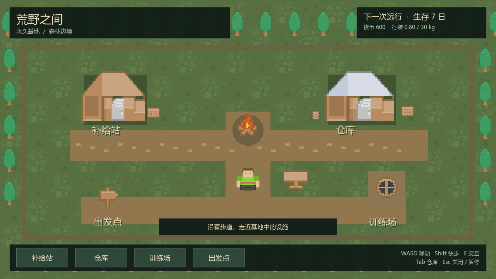
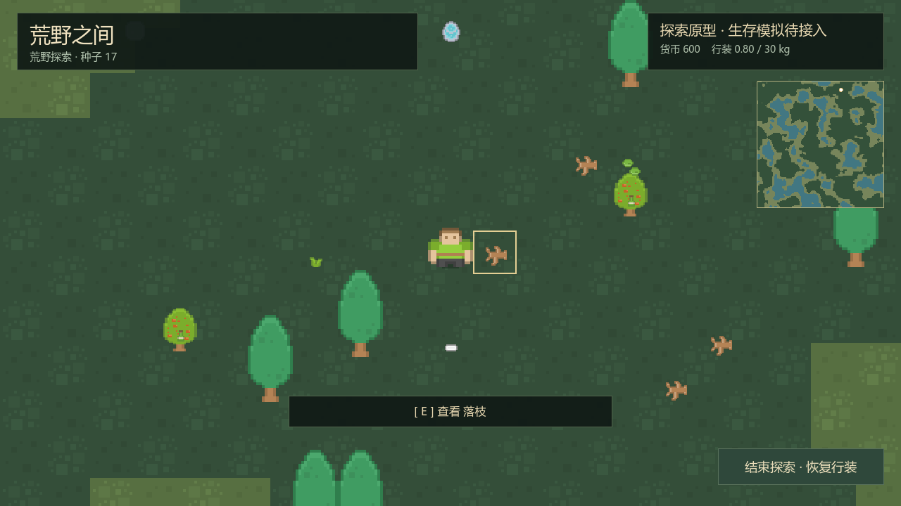
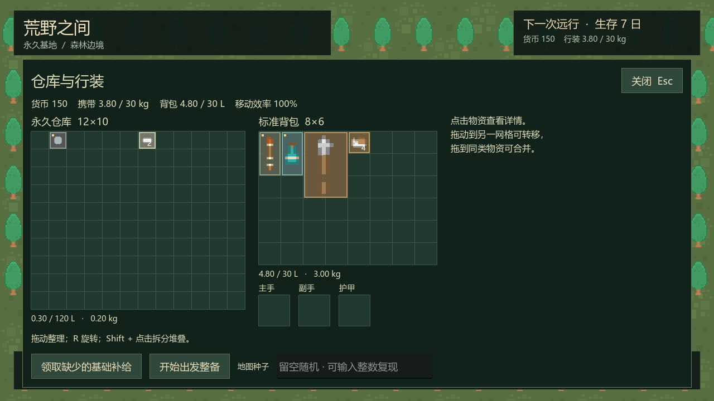

# 免费像素素材替换记录

此页保存首次 Kenney 接入的历史记录；当前版本见 [Ninja Adventure 接入记录](11-ninja-adventure-art.md)。

日期：2026-10-13（Asia/Shanghai）。范围：P0–P2 现有表现层替换，P3 生存玩法尚未接入。

## 来源与选型

使用同系列 Kenney Roguelike/RPG Pack 与 Roguelike Characters（16×16、俯视像素），覆盖森林营地、荒野资源、人物与生存工具。两包官方页面与包内文件均注明 CC0，允许商用与修改。下载链接、原许可证、校验值、图集坐标和适配说明统一保存在 [素材目录说明](../assets/kenney/README.md)。

搜索中也找到 Tiny Town、Forest Camp 和 Mini Meadow；当前采用 RPG 系列，以保持人物、环境和工具的像素尺度一致。未使用免费版仅限非商业项目的资源包。

## 已完成

- 基地：草地、边缘树木、两栋营地木屋、木箱 / 木桶、路牌、训练靶、篝火与长凳图像替换；保留中文设施名。
- 荒野：森林 / 草地 / 水纹理，全部九种资源点的图像替换；交互高亮及附近对象说明保留。
- 人物：基地与荒野共用同一组合角色，左右镜像和背向提示，脚部碰撞沿用既有规则。
- 库存：25 个目录物品都有图像映射，保留占格边界、数量、基础补给标记和详情；拖拽预览与 R 旋转共用图标绘制接口。
- 显式采用最近邻过滤，细长工具裁去透明留白；图像映射与缓存只属于表现层。

本次没有增加采摘、伐木、饮水、训练、身体消耗、动物或联网玩法。部分图标为相近通用物品替代；没有完整角色行走动画。业务脚本、数值、稳定实体 / 物品 ID、存档格式与地图生成器未修改。

## 模块与复现

`WildArtLibrary` 维护语义名到静态图片的映射与库存图标绘制；`WildWorldTiles` 将免费图片适配到原图集契约；各现有视图仅替换绘制。`tools/prepare_art_assets.py` 从官方下载包提取并输出 PNG 和坐标清单，不访问正式存档。

使用 `tools/verify_p2.ps1`、`tools/verify_p1.ps1`、`tools/verify_p0.ps1` 回归。隔离图形预览：Godot MCP 运行 `tests/p2_preview.tscn`；库存预览运行 `tests/p1_capture.gd` 并传入随机 `--profile-store=res://.godot/verification/...cfg`。所有验证档案仅位于工作区 `.godot/verification/`。

## 图形预览

## 最终验证结果

| 检查 | 结果 |
| --- | --- |
| P0 回归 | 34 项通过，0 失败 |
| P1 回归 | 98 项通过，0 失败 |
| P2 完整验证 | 366 项通过，0 失败；100 固定种子，0 次自然回退；最慢 464.23 ms |
| Compatibility 实际图形预览 | 基地、整备、荒野、泉水说明、库存截图已查看；中文标签、像素过滤与图标正常 |
| 素材 | 35 张选用 / 组合 PNG；25 个目录物品覆盖；两包原许可随工程保存 |

各验证脚本退出码均为 0。最终导入与图形运行未发现 GDScript 解析 / 执行错误；受限命令环境提示 `user://` 编辑器快照 / 着色器缓存目录无法创建，隔离验证及截图输出仍正常。Godot 版本为 `4.7.2.stable.official.ed1daf0bf`，图形设备 Intel Iris Xe / OpenGL 3.3。
