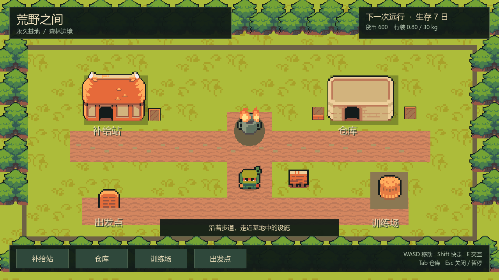
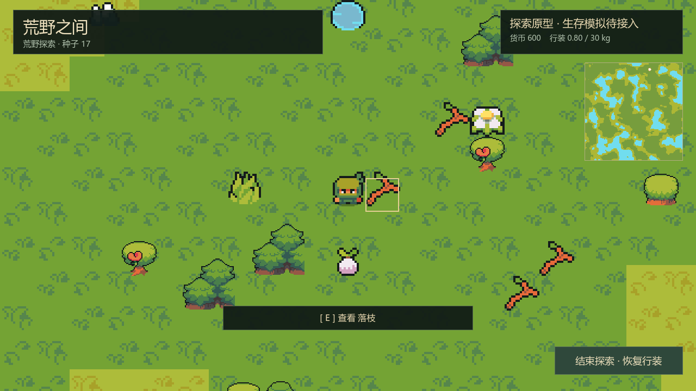
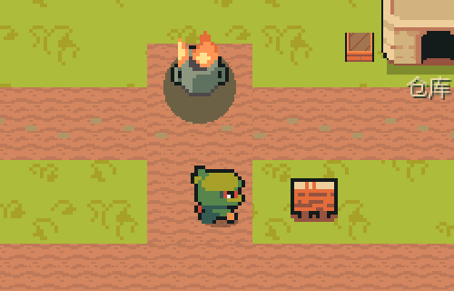
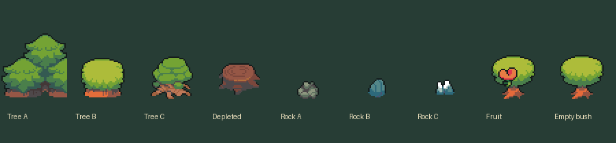
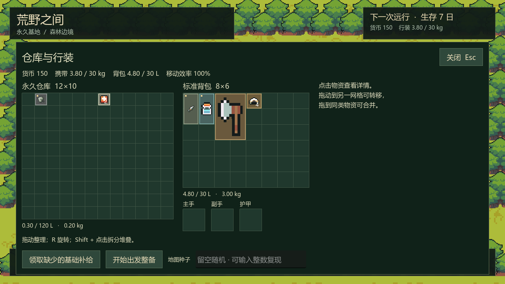

# Ninja Adventure 美术与动画接入记录

日期：2026-10-13（Asia/Shanghai）。当前游戏已从 Kenney 切换为 Ninja Adventure；P0–P2 玩法基线保持，P3 生存模拟尚未实现。

## 来源与授权

使用 Pixel-boy、AAA 的 [Ninja Adventure 官方素材包](https://pixel-boy.itch.io/ninja-adventure-asset-pack)，官网及包内 README / LICENSE 均注明 CC0，可免费用于商业与非商业游戏、修改与再分发。作者、ZIP 校验值、原许可和提取坐标见 [素材来源说明](../assets/ninja_adventure/README.md)。

当前工程只引用 `assets/ninja_adventure/` 的 50 张选用 / 组合 PNG。旧 Kenney 文件保留为历史备份，通过 `.gdignore` 排除资源扫描；其图片和说明仍可在文件系统查阅。

## 已接入

- **人物动画**：NinjaGreen 的四方向待机 / 行走，各四帧；默认待机 4 FPS、行走 10 FPS、快走 14 FPS。输入决定朝向，实际位移决定是否行走；顶住障碍后待机。脚部碰撞与权威位置保持原规则，四方向使用原动画帧。
- **环境动画**：水格四帧涟漪（5 FPS）；基地石圈与八帧火焰组合（8 FPS）。水格动画属于渲染效果，菜单期间仍可能播放，不推进业务时间；人物与基地篝火随单机暂停停止。
- **地形变体**：森林 / 草地各四种原包纹理，以 16px → 32px 最近邻放大；地图格与地形 ID 不变。地图概览跟随新配色。
- **资源变体与差分**：三种树形、三种石形按格子坐标派生，绝不调用世界 RNG；加载耗尽树时显示树桩、加载耗尽浆果时显示无果丛，其余耗尽资源隐藏。来源是原有 `remaining` 快照，没有增加采集指令。
- **基地与库存**：两栋建筑、路径、树木、营地家具、路牌、篝火、25 种库存物品图标、拖拽旋转预览和窗口图标切换为本包素材；中文名称和详情保留。

部分图标是相近物品替代，例如皮甲使用皮革袋、绷带使用医疗包。详见素材目录的替代清单。人物的攻击、游泳、受伤、死亡等其他动作仍保存在原包中，没有作为可执行玩法接入。采集、饮水、身体模拟、动物 AI 和联机仍按阶段计划实现。

## 模块边界

| 模块 | 职责 |
| --- | --- |
| `WildArtLibrary` | 静态图像映射、库存图标、资源变体 / 耗尽差分、篝火组合；没有业务状态 |
| `WildExplorerAnimation` | 每名角色独立的朝向 / 动作 / 帧进度，接收实际位移和秒数；不依赖 UI 路径或会话 |
| `WildBaseExplorer` | 基地碰撞移动后推进动画；荒野通过公开 `animate_motion` 接收会话移动结果 |
| `WildWorldTiles` | 静态地形及水格动画图集；保留 P2 地形起始坐标 |
| 世界 / 库存视图 | 读取快照、绘制新图像、提交既有意图；不改数量、资源、身体或存档 |

没有修改领域规则、数值配置、存档格式、稳定物品 / 实体 ID 或生成器。荒野仍关闭人物自身的基地物理输入，防止重复执行移动。

## 验证结果

| 检查 | 结果 |
| --- | --- |
| P0 / P1 / P2 回归 | 34 / 98 / 366 项通过，0 失败 |
| Ninja 动画与素材定向验证 | **41 项通过，0 失败** |
| 100 固定种子 | 全成功，0 次自然回退；本次最慢 924.94 ms |
| 实际图形验证 | Compatibility / Intel Iris Xe；基地、荒野、泉水说明、库存截图已查看 |
| 动画预览 | 实际四方向输入捕获 20 帧；GIF 展示人物行走和篝火，不是合成的运动效果 |

定向验证覆盖：水帧不越界、25 种物品非空贴图、耗尽差分、基地实际位移 / 停止 / 顶墙、单机暂停、荒野只由权威移动驱动动画，以及表现不修改资源快照。共 539 项检查，退出码均为 0；没有 GDScript 解析 / 执行错误。受限命令环境仍有 `user://` 编辑器快照 / 着色器缓存目录提示，隔离测试与截图正常完成。

复现：

```powershell
.\tools\verify_p2.ps1
.\tools\verify_p1.ps1
.\tools\verify_p0.ps1
.\tools\verify_ninja_art.ps1
```

截图均使用随机 `.godot/verification/` 档案，不打开正式存档。Godot MCP 可运行 `tests/p2_preview.tscn`；四方向动画录制脚本是 `tests/ninja_preview.gd`；库存录制使用 `tests/p1_capture.gd` 并传入随机 `--profile-store`。`tools/assemble_ninja_previews.py` 汇总截图、裁剪真实游戏帧为 GIF 并生成素材差分对照图。

## 预览







下图仅展示图像变体 / 耗尽差分，不代表已经提供玩家采集入口。




