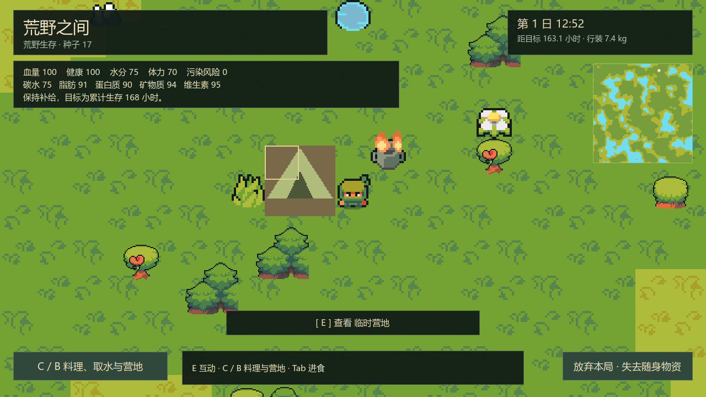
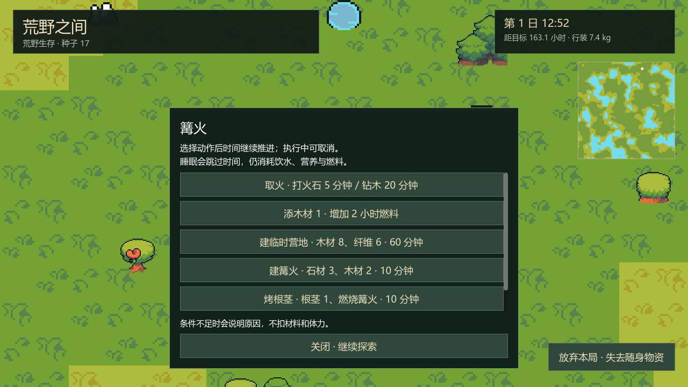
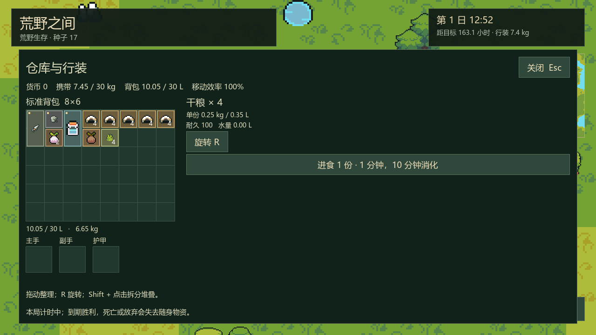
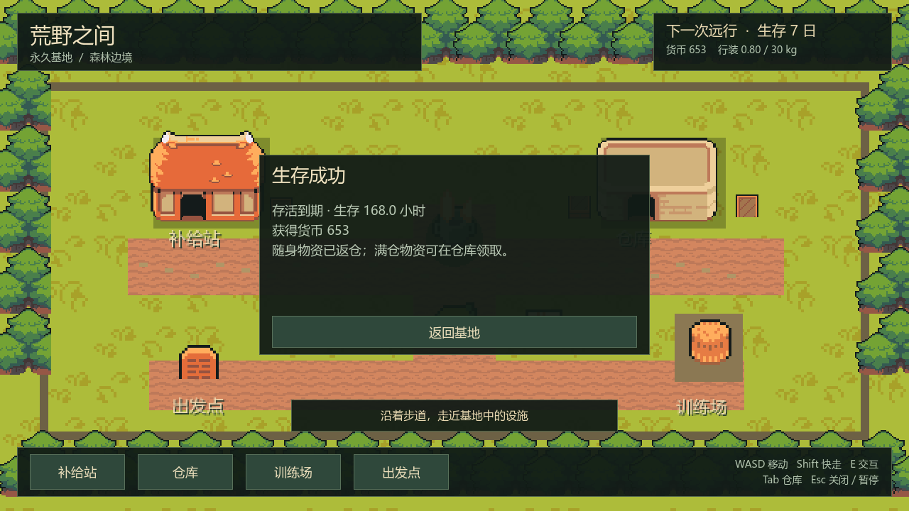

# P3 实施与验证报告

日期：2026-10-13（Asia/Shanghai）。设计基线：0.2。状态：P3 基础单机生存循环完成。

## 1. 当前交付

- 新出发采用真实生存规则：起点第 1 日 08:00，累计生存 168 小时；1 现实秒 = 120 游戏秒。
- 血量、健康、五类营养、水分、体力；基础消耗、短时消化、缺水 / 饥饿伤害、休息恢复、污染风险记录和负重修正。
- 采摘浆果 / 根茎，拾取石材 / 纤维 / 草药 / 落枝，小刀 / 斧头伐木；工具磨损、资源消耗与植物再生。
- 无容器清泉饮水，水壶取水 / 饮用，岸边生水，燃烧篝火煮水；同时检查水量、洁净状态、内部容量与携带重量。
- 临时营地、篝火、取火、添燃料、烤根茎；检查材料、体力、火源、范围和建筑占地 / 通路。
- 实时休息与 1 / 2 / 4 / 8 小时睡眠跳时。跳时仍推进身体、消化、腐坏、火源和资源再生；血量 / 水分危急提前醒来。
- 到期成功、血量归零失败、主动放弃；一次性奖励、胜利随身物资返仓，满仓进入持久待领取列表。
- 生存 HUD、动作选择 / 取消、背包进食 / 饮水、胜负结果、昼夜视觉；保留现有 Ninja Adventure 贴图、人物 / 水面 / 火焰动画。

当前没有复杂疾病 / 医疗、永久技能、捕鱼、动物、狩猎、陷阱、营地升级或实际网络连接。原有装备槽可用，护甲物理减伤随战斗阶段接入。训练场仍是占位入口。旧 P1 / P2 档案保留原规则，新局启用 P3。

## 2. 可以怎样试玩

F5 运行；在基地购买食物，将免费小刀 / 打火石 / 水壶和选购物资装进背包或装备槽，再确认出发。

- E 打开近处对象：采集、泉水饮用 / 取水、营地休息 / 睡眠、篝火取火 / 添燃料、领取工作点产出。
- C / B 打开料理 / 取水 / 建造；材料足够时在附近自动选合法空地。营地木材 8 / 纤维 6；篝火石材 3 / 木材 2。
- Tab 整理随身库存；选中食物进食，选中水壶饮用 0.25 / 0.5 L。清泉也提供 0.25 / 0.5 / 1 L 选择。
- 动作开始后菜单关闭，时间继续；不能同时移动或整理锁定行装。底部可取消，已花时间 / 体力不退，未消耗材料保留。
- 血量或饮水危急先处理再睡。成功自动返航；「放弃本局」需要界面确认并按失败处理，不能免费恢复出发行装。

满包产出留在原工作点，需要腾出空间后靠近领取；未领取产出与营地物资不会随胜利返仓。满仓返航物资在基地仓库领取，必须入仓才能装载或出售。仓库与待领取区处于基地，不随本局荒野时钟腐坏。

## 3. 模块与事务边界

| 模块 | 职责 |
| --- | --- |
| `WildSurvivalContent` / `data/survival_content.tres` | 食谱、配方、费用及基础阈值配置，与实例分离 |
| `WildBodyState` / `WildBodyRules` | 身体、消化与消耗 / 恢复 / 基础伤害，不读取 UI / 背包节点 |
| `WildSurvivalState` | 按玩家 ID 的身体 / 动作、累计时间、燃料、输出、探索与活动记录 |
| `WildInventoryOperations` | 材料预留 / 消耗、产出入包与合并，不决定动作或奖励 |
| `WildBuildingRules` | 建筑占地、范围与不封死通路，派生运行碰撞格 |
| `WildSurvivalActions` / `WildSurvivalCommands` | 开始校验 / 扣体力 / 锁材料，完成时协调消耗、产出与有效活动 |
| `WildSurvivalSimulation` | 分钟步进、输入活动时间段、动作 / 目标边界拆步、普通推进和睡眠同规则 |
| `WildSettlementRules` | 任务收据、奖励、确定顺序返仓与满仓待领取 |
| `WildSurvivalCodec` / 基地档案 | 验证并恢复身体、动作锁、建筑、燃料、输出及结果摘要；不补满属性 |
| 本地会话 / 基地应用服务 | 身份、生成器 / 持久化依赖注入、候选状态提交、时间入口与通知 |
| 生存面板 / HUD / 世界视图 | 只读快照与意图，绘制已有美术和新营地表现 |

应用服务在副本上处理动作完成和结算，文件成功后才提交产出 / 奖励；失败保持原状态与待推进时间，冻结移动并重试。同请求不重复扣体力，结算按 `settlement:<run_id>` 去重，收据与货币 / 物资在同一快照保存。

普通模拟按 1 游戏分钟推进，遇动作 / 目标边界拆步；输入活动时间段保留在待推进队列，操作前先处理已花的不足一分钟时间。每帧不足边界时不复制整张世界。到期先处理身体消耗，再判断死亡 / 胜利，未完成的动作不追加奖励或产出。

材料锁并不提前销毁物品；完成时再次校验材料 / 资源 / 地点。料理期间腐坏或火熄灭时不产生新鲜产物、原料保留。完成产出无法入包时保留为工作点的稳定实例。建筑阻挡与水格区分，营地旁不能凭空取到生水。

## 4. 存档与兼容

仍使用版本 1 的基地整体 JSON，新增可选生存、待领取和结果字段，兼容已有基地 / 准备 / 占位 / 探索档案。

保存累计时间与待推进时间段、身体 / 消化、正在执行的动作及预留实例、资源再生时间、建筑 / 燃料、工作点产出、探索格、活动与动作 RNG 状态。身体、数量、坐标、关联实例、建筑重叠、输出重复 ID 和结果摘要都会校验；无效档案尝试完整备份，不通过重置身体继续。

出发、动作开始 / 完成、睡眠、日切换、结算、每 2 现实分钟、菜单 / 失焦和正常退出形成保存点。失败保留脏状态，正常退出写盘失败时保持窗口。RefCounted 会话的通知使用绑定方法，避免捕获自身的 lambda 与服务构成引用环。

## 5. 验证

复现：`tools/verify_p3.ps1`、`tools/verify_p2.ps1`、`tools/verify_p1.ps1`、`tools/verify_p0.ps1`、`tools/verify_ninja_art.ps1`。测试仅写 `.godot/verification/`，没有打开正式玩家档案。

| 验证 | 结果 |
| --- | --- |
| P3 全部检查 | **119 项通过，0 项失败，退出码 0** |
| 完整 7 日自动策略 | 5 个种子均获胜，累计时间均 168.0 小时，血量均 100 |
| P2 地图 / 文件 / 场景回归 | 366 项通过，100 个种子全部成功，0 次自然回退 |
| P1 库存 / 商店回归 | 98 项通过 |
| P0 基地 / 策略回归 | 34 项通过 |
| Ninja Adventure 动画回归 | 41 项通过 |
| 实际图形 | MCP 运行隔离预览，OpenGL 3.3 / Intel Iris Xe；四张截图已查看，调试输出无错误 / 警告 |

P3 检查包含基础消耗 / 饮食 / 体力、零体力恢复、脱水 / 饥饿死亡、采集 / 伐木守恒、取水容量、煮水、材料锁 / 取消、腐坏 / 熄火失败、运行中读档、睡眠中断、满包产出、满仓返航、同刻死亡优先、完成 / 结算写盘失败重试、重开去重及真实 UI 按钮和单机暂停。

自动策略脚本 `tests/p3_journey.gd` 使用默认 600 资金购买 20 份干粮，采集真实资源、走可达路径、建营地 / 篝火、饮用清泉、料理和睡眠；没有修改 7 日目标、身体补给量或行动费用。测试直接加速调用同一时间规则，不能称为 5 局正常速度人工试玩。5 个种子为 17、18、7936、15855、31693；到期水分分别约 74.9、69.5、96.3、61.7、97.1。

该策略以清泉、食物和 4 小时睡眠稳定通关。当前压力来自补给与行动费用，动物风险尚未接入；探索折返、等待压缩及整体平衡仍需要人工试玩评价。P8 要求的正常速度试玩和目标设备性能验证尚未完成，不以自动通关代替。

验证引擎为 `4.7.2.stable.official.ed1daf0bf`。CLI 编辑器仍有受目录写入限制影响的内置 profiler 提示；资源导入与玩法检查正常，图形 MCP 最后一次调试输出无错误。没有为测试修改系统用户目录权限。

## 6. 实际画面

以下来自 `tests/p3_preview.tscn` 的真实渲染。营地 / 料理状态由默认规则自动策略建立，截图使用随机隔离身份；胜利示例总奖励为 653。

## 7. 下一阶段

按计划进入 P3.5 早期双人联机验证：Godot 高层联机 / ENet、本机双进程与局域网 / IP 连接，房主共享世界快照、移动 / 采集 / 库存权限、公共容器并发与基本原成员重连。完整四人生命周期、睡眠投票与逐人死亡结算在 P6.5 完成。
