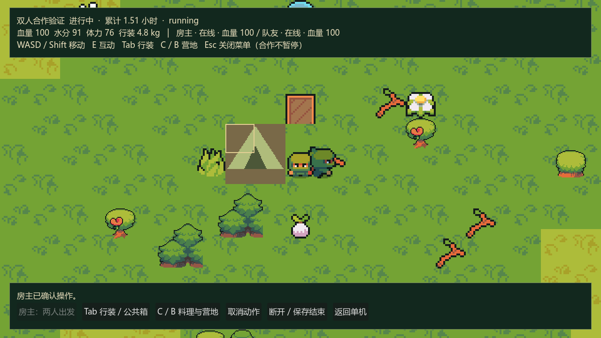
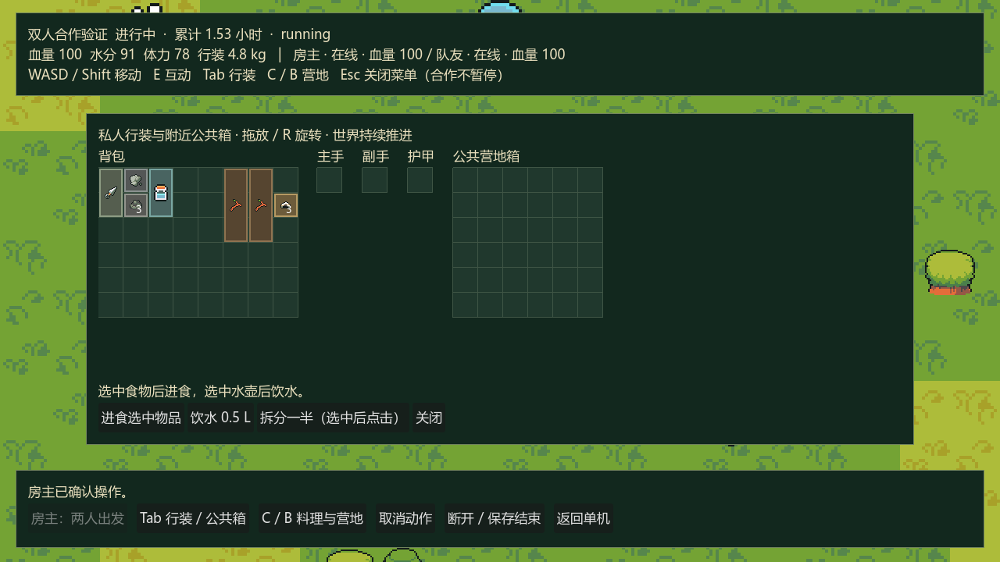

# P3.5：早期双人联机实施与验证

日期：2026-10-13。Godot：4.7.2.stable.official.ed1daf0bf，Compatibility。状态：P3.5 已完成，下一阶段 P4。

两名玩家可以通过本机 / 局域网 IP 连接同一随机荒野，移动、采集、建营地和独立储物箱、转移公共物资，并以原身份重连。这是独立验证版本，使用专用身份、房主世界档案和固定验证物资包；不会从单机永久基地扣除物资，也不会提前发放合作奖励。完整 2–4 人大厅、个人整备转移、睡眠投票、死亡观战 / 尸体和逐人结算仍属于 P6.5。

## 操作入口

1. F5 运行主场景，在基地点击「双人合作验证 · P3.5」，或 F6 运行 `scenes/coop.tscn`。
2. 房主填写昵称、UDP 端口与可选种子，点击「新建验证房间」；队员填写房主 IP 和相同端口，点击「连接 / 原身份重连」。同机两窗口用 `127.0.0.1`，默认端口 7000。
3. 两人都连接后，房主点击「两人出发」。新玩家此后不能加入；已参加的原队员可重连。
4. WASD / Shift 移动，E 交互，C / B 打开制作与建造，Tab 整理行装，Esc 关闭菜单。个人菜单不暂停房主时钟与其他角色。
5. 建临时营地：木材 8、纤维 6、60 游戏分钟、2×2。独立储物箱：木材 6、纤维 4、30 游戏分钟、1×1，容器 6×6 / 40 L，当前基础体力费用 4。箱子必须实际建造，营地不会附赠箱子。走近箱子按 E 或 Tab，在背包和公共箱间拖放；R 旋转，可拆分一半、合并和装备。
6. 行装选中食物进食，选中水壶饮水；泉水、伐木、取火、料理、休息继续沿用 P3 规则。动作开始需房主确认，材料直到完成才扣除，进行中禁止转移该玩家库存。
7. 队员断开后角色原地留存，身体继续推进；取消未完成动作，保留尚未消耗材料，不退已用时间 / 体力。使用同一身份和端点重新连接，恢复原位置、身体和库存，不能再次领取验证包。
8. 房主点击「断开 / 保存结束」或正常关闭窗口，会先保存并取消未完成动作，再结束连接。下次点「恢复房主存档」，原队员再连接。保存失败会提示并保留房间供重试。

每人的验证包是小刀、打火石、空水壶、16 木材、10 纤维、3 石材与3 干粮；仅用于尽早验证合作边界，不是最终合作经济。地图仍使用 P2 的 519 个资源点；按出发人数增加资源 / 危险留待 P6.5。

## 模块与事务

| 文件 | 职责 |
| --- | --- |
| `scripts/domain/coop_state.gd` | 房间、成员、共享世界 / 身体与公共容器的单一保存单元；私人容器按稳定玩家 ID 分开 |
| `scripts/domain/coop_reservations.gd` | 从进行中动作派生资源与建筑占地锁，取消 / 完成 / 恢复无需同步第二份锁表 |
| `scripts/application/coop_service.gd` | 房主校验、原成员重连、候选事务、持久收据、逐人库存视图、集中模拟与断线取消 |
| `scripts/infrastructure/coop_codec.gd` | 复用库存 / 世界 / 身体校验，检查跨玩家实例重复、动作归属与独立箱子完整性 |
| `scripts/infrastructure/enet_room.gd` | ENet 高层 RPC、连接身份绑定、命令重试、输入序列 / 超时、可靠快照与位置帧 |
| `scripts/application/coop_replica_session.gd` | 只读快照、异步意图、位置插值和本地拖放预览，配置 / 目录显式注入 |
| `scripts/presentation/coop_main.gd` | 连接界面、显示、输入、库存与制作菜单组合；不直接修改权威业务状态 |

单机与合作共用库存、建筑、动作与身体规则。分钟模拟通过显式玩家状态视图选取执行者库存，火源 / 世界产出只推进一次，角色活动与负重分别计算；单机路径保持原接口默认行为。

房主根据 RPC 连接绑定身份，忽略报文中的伪造 `actor_id`；拒绝任意坐标目的地、客户端时间增量、错误房间 / 任务和旧容器版本。命令带 `room_id`、`run_id`、`request_id`、操作与参数，成功收据与全体成员 / 世界同事务落盘后才确认。重复请求返回原结果，变更参数重用 ID 拒绝；写盘失败不扣材料、不交付产出、不留下成功收据。

容器版本用于转移、布局、数量、水量、耐久等事务变更，连续腐坏不反复递增布局版本。身体 / 制作仍使用房主当前新鲜度；这样带食物的合作背包不会每半秒因时钟自动成为旧版本。操作前核对已提交的容器版本，再消化积累时间，避免本次时间刷新使自己的请求失效。

重连凭据为本地保存的随机秘密，房主档案只保存哈希。私人快照不含队友库存或任何凭据；公共箱仅在可达交互范围内发送并允许操作。新连接不能用相同身份制造第二个角色；断线取消的保存失败会冻结并记录待取消项，重试仍取消原动作，不会恢复离线生产。

输入发送目标 20 Hz，位置发送目标 10 Hz；房主根据自己的物理帧、配置速度与碰撞推进，不按输入包数量移动。输入超过 250 ms 未更新按静止处理。可靠命令 / 快照使用通道 0，位置 / 输入使用通道 1；客户端按帧序号和世界修订拒绝旧消息，位置指数插值，超过 96 px 的恢复位置直接纠正。移动预测留待 P6.5。API 依据 [Godot 4.7 高层联机文档](https://docs.godotengine.org/en/4.7/tutorials/networking/high_level_multiplayer.html)。

## 档案隔离与恢复

单机仍使用原来的 `profile_identity.cfg` / `base_state.json`。合作验证默认使用：

- `user://coop_host_profile.cfg` 与 `user://coop_guest_profile.cfg`：分别持久保存验证身份，同机两窗口不会共用角色。
- 各身份文件旁的 `_credentials.json`：端点重连秘密。
- `user://coop_validation_room.json`：房主共享世界、全部私人运行库存、公共箱、身体、动作与收据；客户端不保存权威世界。

新建明确覆盖独立验证房间；恢复先检查主档，损坏时尝试同一房主的兼容备份，未知版本 / 其他房主拒绝覆盖。恢复的网络在线标记全部重置；真实连接重新绑定。修复损坏主档时保留良好备份，且先验证身份凭据。异常崩溃恢复最后成功写盘的状态，不承诺房主迁移或跨端经济恢复。

测试档案全部随机放在 `.godot/verification/`。一次直接调用旧 P0/P2 场景脚本时漏传隔离参数，读取了默认路径；核对正式主档与备份仍保持 2026-10-12 19:46:40 的修改时间，未被测试改写。已给 P0/P1/P2 添加脚本内部随机场景档案，P0–P3 / Ninja 检查增加对非验证路径参数的拒绝，避免调用方式遗漏再次访问正式游戏档案。

## 自动与图形验证

入口：`tools/verify_p35.ps1`。Windows 本机双进程，各次分配随机端口并绑定 `127.0.0.1`，仅结束本次测试创建的进程。受限沙箱会阻止 UDP 回环；已获准在回环范围运行真实进程测试，无外部服务器。

| 检查 | 通过 | 失败 |
| --- | ---: | ---: |
| 房主领域规则、事务、恢复、材料 / 占地锁 | 80 | 0 |
| 真实合作 UI 控件、异步结果、断开界面、备份恢复与凭据版本保护 | 22 | 0 |
| 真实 ENet 双进程，正常网络：房主 / 客户端 | 37 / 24 | 0 |
| 真实 ENet 双进程，100 ms / 1% 应用报文故障：房主 / 客户端 | 37 / 26 | 0 |
| P3 单机生存回归，含 5 种子各 168 小时自动策略 | 119 | 0 |
| P2 场景 / 世界 / 档案定向回归，跳过未改动的 100 种子抽样 | 53 | 0 |
| P1 库存 / 基地回归 | 98 | 0 |
| P0 场景 / 身份 / 会话回归 | 34 | 0 |
| Ninja Adventure 动画 / 图像回归 | 41 | 0 |

P3.5 共 226 项，回归 345 项。覆盖抢同一资源、同格建造、材料预留、独立储物箱耗材、公共箱旧版本竞争、重复收据、伪造执行者、失败回滚、离线身体、原成员重连、拒绝新成员、房主保存结束与恢复；无物资 / 材料 / 角色复制。UI 检查调用实际控件与组合根，图形预览使用明确的第二角色显示夹具；真实网络证据来自另行运行的两个独立 Godot 进程。

故障注入是**真实 ENet 上的应用报文延迟 / 丢失**：每向延迟 50 ms，每 100 个发送报文丢弃 1 个，另定向丢弃一次库存请求验证相同 ID 重试。未执行 OS 层 UDP 整形，不能称为测得真实网络链路 1% 丢包。可靠事务在应用层 600 ms 重试，位置靠后续帧恢复。包数、丢弃数、重试和命令完成时间保存在 `docs/evidence/p35-*-result.json`，详细日志与最新隔离案例路径在 `.godot/verification/p35-latest-cases.txt`。

本次保存的正常网络客户端命令均值 182.8 ms / 最大 451 ms；故障配置均值 290.2 ms / 最大 814 ms（含刻意丢失后的重试）。故障配置房主发送 751 条报文、周期丢弃 7 条；客户端发送 1569 条、周期丢弃 15 条，另定向丢弃 1 条库存请求、重试 1 次。时间包括应用排队、房主保存和帧调度，不是 ENet 原始 RTT 或性能达标结论；最终帧率 / 存档延迟优化留待 P8。

Godot MCP 已运行 `tests/p35_preview.tscn`，实际 OpenGL 3.3 / Intel Iris Xe Compatibility。保留 Ninja Adventure 人物 / 地形 / 水动画与箱子图像；显示两个角色、公共箱和不暂停的制作菜单。预览不打开正式档案，不代表人工完成联机 7 日或跨设备局域网试玩。

其余截图：[连接界面](previews/p35-lobby.png)、[合作营地菜单](previews/p35-actions.png)。

## 下一阶段与边界

按计划进入 P4：完整身体状态、营养缺乏、饮水 / 体力修正、疾病与治疗，继续通过单机与已验证的双人会话运行。完整四人生命周期、尸体 / 观战、睡眠投票、主动赠送、永久基地物资跨端转移、个人奖励与困难倍率仍留在 P6.5。当前验证版本没有平台邀请 / 中继、房主迁移或客户端预测；这些入口没有被描述为已经完成。
