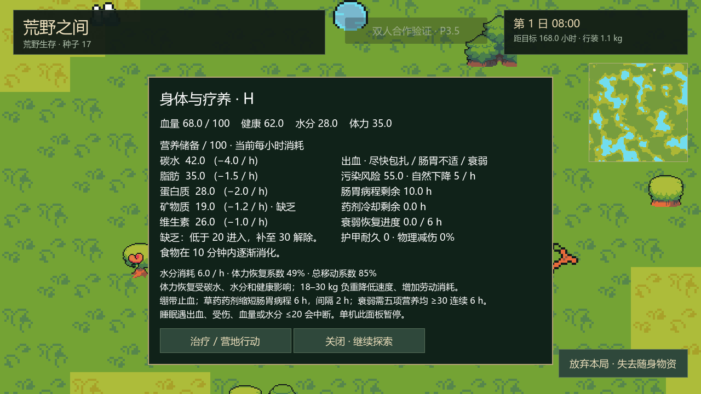
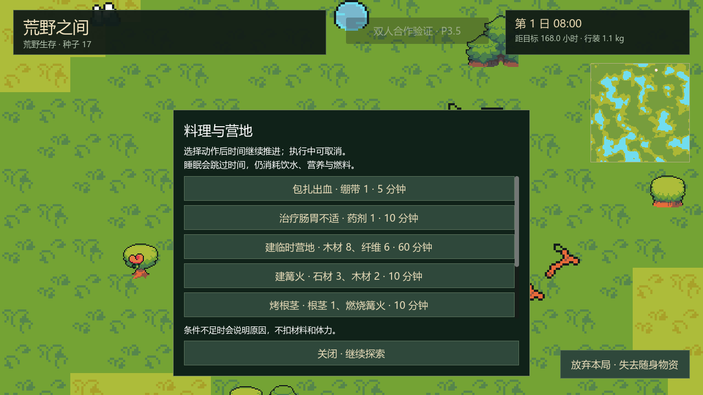

# P4 身体与疾病：实施与验证

完成日期：2026-10-13。Godot `4.7.2.stable.official.ed1daf0bf`，Compatibility / OpenGL 3.3，保留 Ninja Adventure 美术。P0–P4 已完成，下一阶段 P5；完整四人生命周期仍待 P6.5。

## 已实现玩法

- 五项营养、线性并行消化、腐坏食品半量营养、生水 / 生食 / 变质食物污染，沿用既定食品和每小时消耗数值。
- 营养不足与脱水采用迟滞：低于 20 进入、达到 30 解除；营养健康损耗合计每小时最多 4，脱水另扣 2，水分归零才额外掉血。碳水和脂肪连续低于 10 两小时进入饥饿，任一达到 20 解除。
- 出血每小时血量 −4 / 健康 −1，不自动止血；肠胃不适额外水分 −2 / 健康 −2，病程 12 小时；营养连续不足 24 小时产生衰弱，五项均达到 30 连续 6 小时解除。
- 污染自然每小时下降 5；达到风险阈值且未患肠胃病时按既定概率作小时检查。每名角色使用独立、持久化的疾病随机序列，不与地图 / 取火随机流混用。健康本身不随机触发其他疾病。
- 水分、碳水、健康、衰弱影响体力恢复；衰弱影响速度和回血，负重继续影响速度和高强度费用。安全营地休息恢复健康；零健康不直接死亡，死者不会被休息复活。
- 皮甲减免 35% 物理伤害，上限 60%；命中耐久 −2，归零失效；疾病、脱水和出血绕过护甲。最终物理伤害 ≥10 才有 20% 出血概率，同类状态不叠加。
- 包扎耗时 5 分钟、绷带 1、体力 0；草药药剂耗时 10 分钟、药剂 1、体力 0，缩短剩余病程 6 小时，生效后开始 2 小时冷却。开始和完成都检查条件，取消或病情已消失不消耗物品。确实减少病情才记有效治疗活动 `healing`，该活动沿用首次完成 +10 的奖励规则，技能经验待 P5。
- 单机睡眠拒绝 / 中断出血，继续保留低血量、低水分中断；权威伤害入口会唤醒睡眠。普通时间与睡眠共用身体积分，阈值、消化、病程结束与小时风险检查拆步，避免提前收取阈值后的整分钟伤害。

H 或「身体 / 疗养」打开详情，可查看营养及消耗、病程、药剂冷却、衰弱恢复进度、污染、护甲、体力恢复与移动系数。单机暂停，合作持续刷新并推进世界；关闭后继续探索。详情内「治疗 / 营地行动」、C / B 的随身药品选项，以及单机库存选中药品的按钮均走会话意图。合作库存也可使用选中的私人药品；公共箱的药品须先取入自己的行装。

新建合作验证房间每人新增 2 绷带 / 2 草药药剂，方便直接试玩医疗；仍是独立验证包，不从永久基地扣物资。恢复旧房间只恢复原物资，不补发或复制药品。





上述图像来自独立测试伤病夹具。动物与攻击交互尚未开放：护甲和物理出血的领域 / 事务接口已实现并验证，常规动物攻击触发将在 P6 接入。医疗制剂制作和技能加成待 P5；首版三种伤病外的疾病未扩展。合作睡眠投票、复活以外的观战 / 尸体流程和逐人奖励仍按 P6.5 计划推进。

## 模块与数据边界

| 模块 | 职责 |
| --- | --- |
| `health_config.gd` / `data/health_config.tres` | 身体阈值、病程、损耗、概率、治疗和护甲的只读配置，通过 `WildGameConfig.health_rules` 注入 |
| `body_state.gd` | 身体实例、消化、迟滞标志、逐营养连续计时、病程 / 冷却和个人随机序列 |
| `body_rules.gd` | 统一时间积分、营养 / 水分 / 体力与恢复；不访问库存节点 |
| `illness_rules.gd` | 症状迟滞、衰弱系数和污染概率 / 个人随机流 |
| `medical_rules.gd` | 治疗条件与身体效果；耗时、物品预留与消耗仍归行动模块 |
| `damage_rules.gd` | 按伤害原因应用护甲、耐久、出血与睡眠中断 |
| `body_health_codec.gd` | 新身体子版本与字段校验、旧档兼容 |
| `body_view.gd` / `body_details.gd` | 权威只读反馈 / 共享界面，UI 不修改身体 |

单机 / 房主服务提供内部 `apply_world_damage` 事务：先处理已有时间，再在副本上应用伤害与结算、保存成功才提交。没有对应的客户端伤害操作。医疗沿用已有动作事务、请求收据和私人库存权限；失败写盘保留原状态，可用同一请求重试。

总存档版本仍为 1，身体新增 `body_version=1`。旧 P3 身体保留血量、营养、消化和累计生存时间，并补默认病情 / 稳定个人随机流；不追溯尚未记录的低营养 24 小时计时。新档恢复疾病、药剂冷却、迟滞和恢复进度；未知子版本、越界时间、无效随机序列、已经完成却仍标记衰弱的恢复状态均拒绝。JSON 浮点往返比较允许 1e-6 误差，随机序列与标志必须完全一致。

网络高频帧调整为位置和血量 / 健康 / 水分 / 体力四项即时数值，客户端合并这些字段而不丢弃完整身体详情。疾病、营养、护甲和解释数据继续使用可靠状态快照。此次双人夹具的高频载荷为 **588 字节**，低于测试 1200 字节预算，避免增加疾病字段后出现 ENet MTU 警告；此值不含 RPC / UDP 封装，也不代表四人最终载荷。

## 验收结果

全部测试使用内存或随机 `.godot/verification/` 档案；真实网络仅绑定 `127.0.0.1` 随机 UDP 端口。没有打开正式基地档案。正式主档与备份的长度 / 修改时间保持 `196248 / 196247` 字节、`2026-10-12 19:46:40`。

| 验证 | 通过 | 覆盖 |
| --- | ---: | --- |
| P4 领域 | 98 | 缺乏 / 脱水迟滞与损耗、连续计时、病程 / 随机流、两组各 1000 个固定随机种子的出血 / 污染抽样、恢复系数、护甲、治疗取消 / 重试 / 去重、旧档 / 异常档、离线个人状态 |
| P4 实际 UI | 16 | H、身体症状与数值、单机暂停、真实治疗按钮、治疗完成反馈、返基地隐藏控件、合作只读界面继续计时 |
| P4 正常双进程 ENet | 21 房主 + 22 客户端 | 私人治疗、伪造角色 / 外人物品拒绝、冷却、菜单不中断时间、离线病程、原成员重连与房主读档 |
| P4 故障双进程 ENet | 21 房主 + 23 客户端 | 每向 50 ms 延迟、每 100 个应用报文丢 1 包；额外定向丢失一次包扎请求，600 ms 同 ID 重试，物品不复制 |
| P3.5 回归 | 226 | 80 领域、22 UI、正常 61 / 故障 63 真实网络；库存 / 独立公共箱 / 建造锁 / 重连 |
| 其余回归 | 345 | P3 119、P2 定向 53、P1 98、P0 34、Ninja 41 |

P4 新增验收共 **201 项**，回归 **571 项**。P3 的五个地图种子 `17 / 18 / 7936 / 15855 / 31693` 在新身体规则下均完成 168 小时并获胜。策略加速模拟与固定概率抽样不代替正常速度人工平衡试玩；网络注入作用于真实 ENet 上的应用报文，未做 OS UDP 链路整形、跨设备 LAN 或四人测试。

P4 故障组房主发送 143 报文 / 丢 1，客户端发送 269 / 常规丢 2 / 定向丢 1 / 重试 1；客户端十次交互平均 242.5 ms、最大 768 ms，包含定向丢失的重试、房主保存和帧调度成本，不能当作单纯的往返链路延迟。

Godot MCP 图形预览实际使用 Intel Iris Xe / OpenGL 3.3，身体与医疗页面已检查，运行输出 `errors: []`。截图展示测试布置的病情；正式存档未用于预览。早期验证发现网络 MTU 与 JSON 浮点比较问题后已修复并重测。

运行：

```powershell
.\tools\verify_p4.ps1
.\tools\verify_p35.ps1
.\tools\verify_p3.ps1
```

图形隔离场景：`tests/p4_preview.tscn`。领域 / 界面 / 双进程证据保存于 `docs/evidence/p4-*.log` 与 `p4-*-result.json`；此前系统回归证据为 `p4-p*-regression.log` 和 `p4-ninja-regression.log`。

下一阶段 P5：技能实践与永久学习、捕鱼、陷阱、营地升级、更多料理和药剂制作。继续保留同一房主权威、动作事务及个人成长边界。
