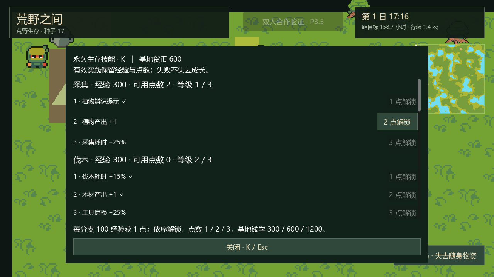
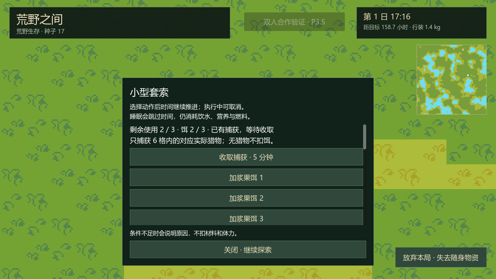
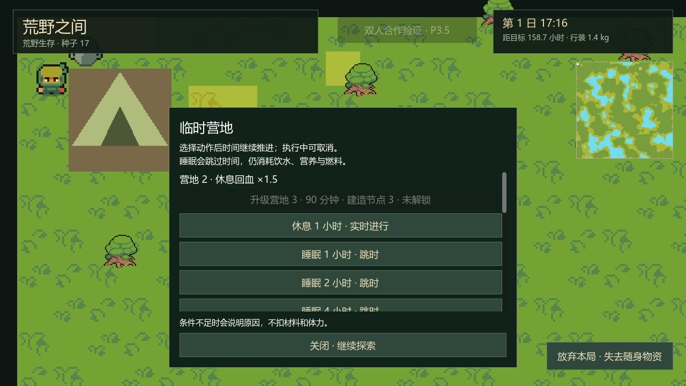
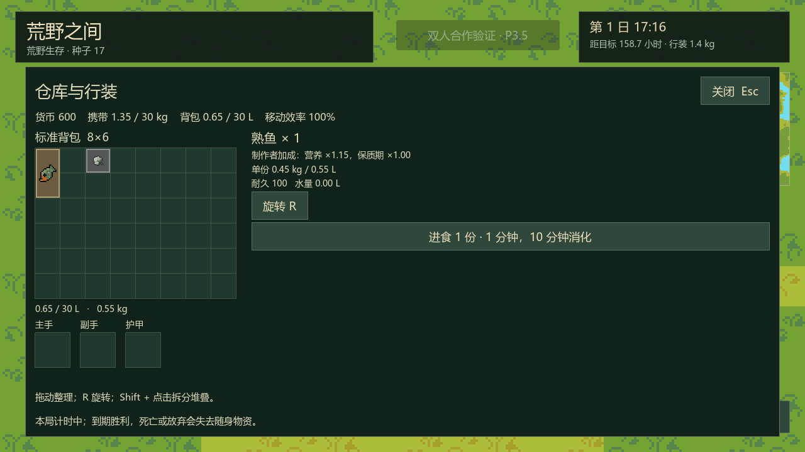

# P5 技能、捕鱼、陷阱与营地升级：实施与验证

完成日期：2026-10-13。Godot `4.7.2.stable.official.ed1daf0bf`，Compatibility / OpenGL 3.3，保留 Ninja Adventure 美术与动画。P0–P5 已完成，下一阶段 P6 动物、狩猎与战斗；完整 2–4 人合作仍待 P6.5。

## 已实现玩法

K 或基地训练场打开技能面板。九分支、27 节点共用 `data/skill_catalog.tres`：每分支累计 100 经验产生 1 点，三级节点依次花费 1 / 2 / 3 点，也可在基地依次花费 300 / 600 / 1200 货币学习同一节点。两种路径检查同一前置条件，货币学习不赠经验 / 点数，不重复扣费。单机经验、等级、已用点数属于永久档案，死亡 / 放弃 / 重开保留。UI 展示等级、经验、余额、费用、门槛与失败原因，只通过会话提交意图。

有效实践奖励沿用配置：采集 / 取火 / 料理 4，伐木 / 捕鱼 / 陷阱收取 8，建造 8，有效治疗 6。失败或无产出不发经验；取水、饮水、整理库存、投饵、维护、拆除与药剂制造不发经验。每人每局同建筑配方仅前三次有效完工发建造经验，拆建不无限获点；重复点燃同一批燃料不发经验。狩猎有效击杀经验 12 的配置保留，击杀路径待 P6。

技能效果已接入采集 / 伐木产量与耗时、工具磨损、取火成功率与耗时、燃料持续、捕鱼、陷阱门槛与概率、营地升级 / 料理台 / 皮甲、炖食 / 熟食营养与保质期、草药制作 / 治疗 / 疗养回血。狩猎 1 开放简弓与箭的制作，狩猎 2 提供静态猎物 / 栖息信息；武器攻击、动态足迹、狩猎 3 掉肉加成在面板中明确标为 P6。

### 捕鱼

携带可用钓具，在鱼点用浆果或纤维投饵。基础 30 游戏分钟、体力 6、成功率 60%，完成磨损钓具 1；成功交付一份生鱼并获 8 经验。捕鱼 1 成功率增加 10 百分点，捕鱼 2 双份模式消耗两份饵、独立判定，捕鱼 3 耗时 ×0.75。成功率上限 90%；双份模式须鱼点至少两份存量，成功才扣实际份数。

饵在开始时消耗，取消 / 失败不退饵；没有产出不获经验。鱼点每 12 游戏小时补两份、上限六份；补给计时与每名角色的捕鱼随机序列保存，菜单、离屏与读档不刷新资源。满包产出留工作点，沿用领取事务。

### 陷阱与实际猎物

小型套索需要陷阱 1，纤维 4 / 木材 1，20 分钟 / 体力 4、占地 1×1；大型需要陷阱 2，木材 4 / 绳 2 / 石 2，30 分钟 / 体力 6、占地 2×2。制作同时安放。投饵使用实际浆果，上限三份；小型每六小时以 40% 检查兔，大型每八小时以 35% 检查野猪，陷阱 3 增加 15 百分点，上限 80%。陷阱持有者后来学习的加成也适用于已有陷阱。

P5 为此生成独立随机流的 **20 个兔 / 6 个野猪静态栖息实体**，位于可达森林且距出生至少 30 格；陷阱六格半径内须有匹配的实际存活实体。捕获把该实体标记为死亡并记录唯一 ID，没有猎物不耗饵 / 随机判定。成功耗一份饵和一次使用数，占用至收取；兔产肉 1 / 皮 1，野猪产肉 3 / 皮 2，只有实际收取者获经验。捕获肉类从捕获时开始计腐坏，重复收取不复制物资。

最多五个有效陷阱，统计包含其他人的在建陷阱及耗尽陷阱修复预留；开始 / 完成均校验。三次成功后耗尽，纤维 2 / 10 分钟 / 体力 4 维护增加一次、最多三次。动物移动、警觉、刷新、狼、攻击与动态足迹继续在 P6，当前标记不代表完整动物玩法。

### 营地与制作

营地 2 扩至 3×3、回血 ×1.5，营地 3 扩至 4×4、回血 ×2，分别需要建造 1 / 3；材料、90 分钟 / 体力 25 沿用配置表。升级先在地图副本检查水面、资源、角色、建筑及通路，完工再检查扩展空间，失败释放材料预留。营地等级回血与医疗疗养加成相乘；睡眠危险受扰倍率已有配置，危险动物事件待 P6。

新增料理台、绳、箭、简弓、皮甲、熟鱼 / 熟肉、炖食、草药药剂。基础烤食无需技能或料理台，炖食要求料理 1、料理台、篝火及清水 0.25 L；原料支持鱼或肉。药剂要求医疗 1、燃烧篝火、草药 2 与清水 0.25 L。耗时、体力、材料与条件由统一动作事务处理；寻找满足条件的随身水壶，清水只在成功完成时扣除。

熟食营养 ×1.15 / 保质期 ×1.5 由制作者技能写入实例，交给队友仍保持品质；拆分继承品质，同品质合并取最早到期时间，不同品质拒绝合并并自动分堆。

拆除 15 分钟 / 体力 5，返累计实际投入的可回收材料各 50% 向下取整；陷阱再乘剩余使用数 / 3，已用饵与燃料不返。公共箱须先清空，拆除中锁转移，完工移除箱子注册，客户端不能伪造“已清空”。

## 单机 / 合作与存档边界

单机技能菜单暂停，合作 K / H / 库存继续推进世界。共享设施检查当前执行者自己的技能，经验归执行者；捕鱼、升级占地、收取 / 修复 / 拆除按房主动作锁串行校验，客户不能提交经验或直接设置随机结果。显示快照去掉陷阱未来随机序列。

合作仍为独立双人验证入口。新房间每人增加钓具、600 验证货币，出发前可 K 学习，出发后只接受实践点数解锁。个人技能保存于房主验证房间，原成员重连 / 房主恢复不会重置；旧房间不补发装备或货币。跨设备永久基地成长同步、装载转移、四人、睡眠投票、观战 / 尸体、逐人奖励与多人倍率仍属 P6.5。

最后操作确认丢失的故障检查暴露了结束房间时的反馈缺口，现补发各玩家自己的最近 32 条操作结果，并在关闭宽限期重发终态。客户端幂等恢复仍等待的确认再结束；未被收据覆盖的操作报告结果未知。该近期反馈缓存不代替 P6.5 的永久跨端提交与对账。多人菜单时钟检查使用有界状态等待，避免并行验证负载下旧快照造成错误结论。

总版本仍为 1，新增技能与 `progression.version=1` 子结构；旧档缺少技能默认空，已有身体、时间、材料与动作保留，首次模拟初始化栖息实体 / 鱼点再生。严格校验技能、计数、捕获 / 猎物链接、材料投入、食品品质、随机序列与待完成动作。未来总版本或任一已知子结构的未知版本拒绝覆盖，即使存在可读旧备份也不降级。

| 模块 | 职责 |
| --- | --- |
| `skill_catalog.gd` / `data/skill_catalog.tres` | 只读九分支 / 节点、费用与加成配置，由 `game_config.skill_rules` 注入 |
| `skill_profile.gd` / `skill_rules.gd` | 个人成长实例、点数计算、前置 / 费用与有效经验 |
| `progression_actions.gd` | 捕鱼、配方、升级、陷阱操作、拆除的条件 / 交付，统一动作层处理体力 / 材料 / 事务 |
| `progression_world.gd` / `trap_rules.gd` | 栖息实体、鱼点再生、个人随机流、世界时间捕获 |
| `action_outputs.gd` | 产出实例、料理品质、年龄、自动入包或工作点留存 |
| `skill_codec.gd` / `progression_codec.gd` / `save_versions.gd` | 新状态校验、旧档兼容与未来版本保护 |
| `progression_view.gd` / `skill_panel.gd` | 权威只读视图 / 共享技能界面；不依赖领域状态的场景路径 |
| `enet_room.gd` | 房主来源绑定、RPC / 快照 / 重试及终态收据，不实现技能公式 |

## 验收结果

测试均使用内存或随机 `.godot/verification/` 档案；真实网络仅绑定 `127.0.0.1` 随机 UDP 端口。正式基地未用于测试，主档与备份元数据仍为 `196248 / 196247` 字节、`2026-10-12 19:46:40`。

| 验证 | 通过 | 主要覆盖 |
| --- | ---: | --- |
| P5 领域 | 220 | 27 节点 / 前置 / 费用、加成、无效操作零经验、失败回滚 / 去重 / 成长保留、鱼 / 饵守恒、大小陷阱 / 实际猎物 / 维护上限、营地 2 / 3 / 扩地失败、料理品质 / 清水、旧档 / 未来版本 / JSON |
| P5 实际 UI | 33 | 基地训练 / K / 点数按钮、单机暂停、动作入口 / 锁、失败保留成长、合作验证学习与终态确认 / 幂等 / 未知反馈 |
| P5 正常双进程 ENet | 38 房主 + 30 客户端 | 逐人学习 / 经验、私人权限、同鱼点 / 升级 / 捕获并发、真实钓鱼、离屏捕获、重连与房主 JSON 恢复 |
| P5 故障双进程 ENet | 39 房主 + 31 客户端 | 每向 50 ms / 每 100 应用报文丢 1；额外定向丢失捕鱼请求和最终确认，重试不重复耗饵 / 发经验，保存结束仍恢复结果 |
| P4 回归 | 201 | 98 领域、16 UI、43 正常 / 44 故障网络 |
| P3.5 回归 | 226 | 80 领域、22 UI、61 正常 / 63 故障网络 |
| 其余回归 | 345 | P3 119、P2 定向 53、P1 98、P0 34、Ninja 41 |

新增检查 **391 项**，回归 **772 项**，全部通过。P3 的 `17 / 18 / 7936 / 15855 / 31693` 五个种子均完成 168 小时并获胜；P2 本轮执行定向检查，未重复此前已通过的 100 种子抽样。P5 网络钓鱼按实际时间完成，营地 / 六小时捕获等待由测试夹具通过同一领域模拟加速；未宣称正常速度人工平衡试玩、跨设备 LAN、合作整局七日或四人已完成。

P5 故障组房主发送 316 报文、常规丢 3 / 定向丢 1，客户端发送 610、常规丢 6 / 定向丢 1 / 重试 1。高频位置 / 即时身体载荷 572 字节（不含 RPC / UDP 封装），仍低于 1200 字节测试预算。延迟和丢失作用于真实 ENet 的应用报文层，不是 OS UDP 链路整形。

Godot MCP 实际使用 Intel Iris Xe / OpenGL 3.3，技能、营地、陷阱、料理和合作大厅 / 库存画面已检查；修正变量遮蔽警告后最终运行输出 `errors: []`。本报告截图来自隔离夹具，正式存档未用于预览。

运行 `tools/verify_p5.ps1` 执行本阶段领域 / UI / 双进程验收；回归入口为 P4、P3.5、P3、P2、P1、P0 与 Ninja 验证脚本。图形隔离场景为 `tests/p5_preview.tscn`，合作显示夹具为 `tests/p35_preview.tscn`，真实网络单独验证。

证据保存于 `docs/evidence/p5-*.log`、`p5-*-result.json` 与 `p5-godot-mcp.json`；截图在 `docs/previews/p5-*.png`。下一阶段按计划实施 P6 动物 AI、警觉 / 逃跑 / 攻击、近战 / 弓箭、护甲受伤、实际掉落与安全区。
