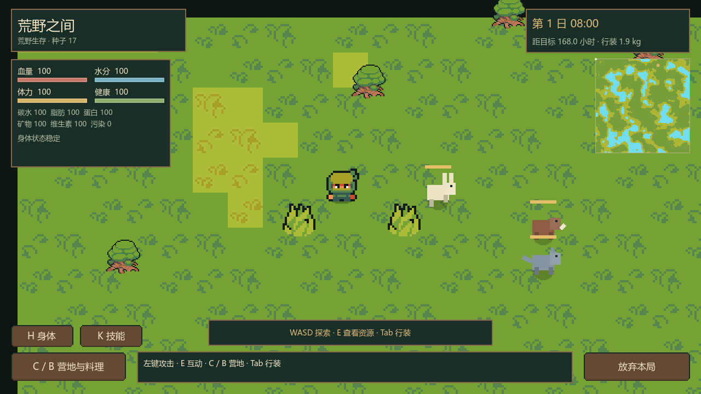
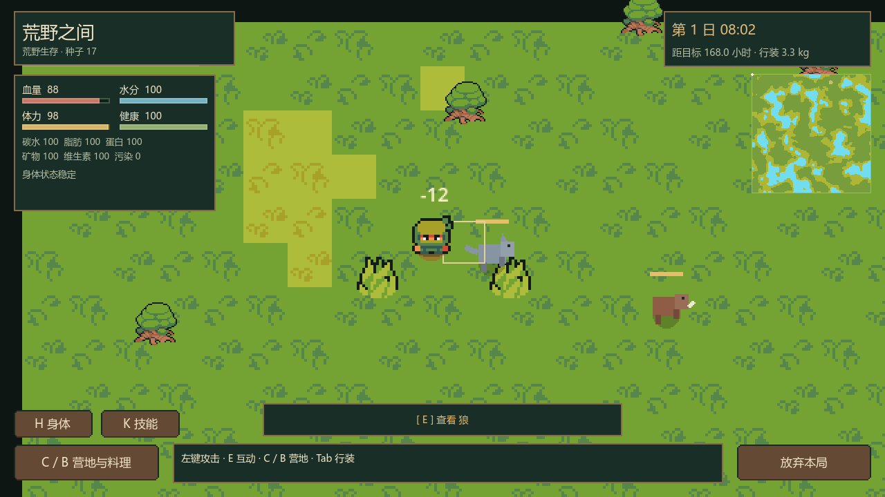
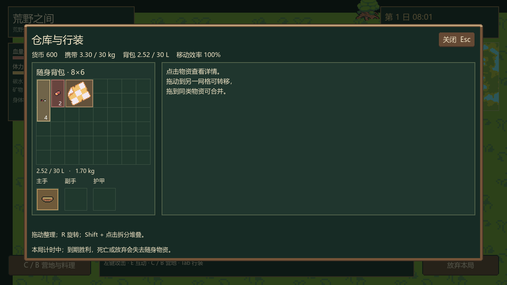

# P6 动物、狩猎与战斗：实施与验证

完成日期：2026-10-14。Godot `4.7.2.stable.official.ed1daf0bf`，Compatibility / OpenGL 3.3。P0–P6 已实现并验证；下一阶段 P6.5 完整 2–4 人合作生命周期。

## 已实现玩法

主手装备耐久至少 1 的小刀、斧或简弓，关闭菜单后 **左键向鼠标方向攻击**。小刀伤害 14 / 冷却 0.7 现实秒 / 体力 4，斧 22 / 1 秒 / 7；弓 30 / 1 秒 / 6，需狩猎 1、实际箭一支，射程八格、箭速八格 / 现实秒。负重增加高强度体力费用，攻击磨损武器 1；同角色换武器不能绕过冷却。零体力、缺装备 / 箭、未解锁或正在执行劳动均拒绝，并显示原因。

近战范围一格、朝向扇区内选择最近实际活体，检查墙体 / 水面；箭为有飞行过程的持久化实体，四像素分步碰撞防止穿墙，先遇实际动物则命中，碰到水面 / 建筑 / 边界或到达射程消失。客户端只能提交方向，不能指定命中、任意坐标、伤害、经验或掉落。空挥和射空仍耗体力 / 磨损 / 箭，零经验；友方不参与伤害判定。

死亡先提交动物生命 / 唯一掉落标记，再交付实际肉 / 皮与执行者狩猎经验 12。兔掉肉 1 / 皮 1，野猪 3 / 2，狼 2 / 1；狩猎 3 额外肉 1。重复命中、另一发箭、重发请求、陷阱捕获后的猎杀不能复制掉落。产出沿用自动入包与满包工作点领取；肉类料理与腐坏继续复用 P5。

### 动物与危险

- 单机初始兔 20 / 野猪 6 / 狼 3，血量 20 / 70 / 50。动物有稳定 ID、实际位置、森林栖息点、生命、行为、目标、冷却和独立随机序列。
- 兔六格内警觉逃跑；野猪四格内警觉，受到攻击后反击；狼八格内感知并追击。警觉检查视线，移动以实际可通行格碰撞，直线受阻时搜索有界短路径。
- 野猪伤害 15 / 1.5 现实秒、狼 12 / 1.2 秒，使用 P4 的护甲、耐久和物理出血规则。皮甲减伤 35%、命中磨损 2；疾病 / 脱水仍绕过护甲。动物不会攻击已死亡角色。
- 超过栖息点十六格解除目标并返回，返回途中不重新追击；游走半径四格，默认速度兔 / 野猪 / 狼为 64 / 56 / 80 px/现实秒，普通游走使用该速度的 35%。碰撞分步防穿水面或建筑。
- 初始栖息点在可达森林、距出生至少三十格；首六游戏小时危险动物禁止进入出生半径六格，玩家引怪不能绕过保护。
- 每二十四游戏小时，在所有角色视野外的可达森林补兔 4 / 野猪 1 / 狼 1，存活上限 24 / 8 / 4。刷新检查实际数量，不复活已捕获 / 猎杀 ID；保存递增序号，恢复时拒绝会覆盖现有实体的序号。
- 狩猎 2 可看到动物移动留下的真实足迹及栖息格；足迹保存六游戏小时，最多 128 条，读档保留，未学习者不收到足迹视图。

每个动物、刷新、个人睡眠风险与疾病分别使用持久随机序列。营地附近六格有危险动物时，每游戏小时检查 20% 受扰概率，乘营地 1 / 2 / 3 的 1 / 0.6 / 0.3；无危险动物不抽随机。真实攻击必定唤醒。近处危险与箭采用至多 0.1 现实秒对应的模拟子步，单机醒来清除未推进的睡眠跳时；实时与睡眠共用规则。

动物画面使用原生像素形状、简易步行动效、血条与伤害数字，作为本阶段可玩的表现版本；Ninja Adventure 人物、地形、道具和动画继续保留。完整动物美术细化与体验调优留在 P7–P8，未引入新的外部素材授权。

## 单机、合作与持久化

单机菜单暂停战斗与世界；合作个人菜单继续模拟。动物 AI、投射碰撞、伤害、死亡和掉落均由本地 / 房主领域规则决定，网络没有直接伤害入口；操作采用候选副本、保存成功提交和原请求 ID 重试，写盘失败不能提前扣箭 / 发掉落。

出发时固定人数，动物数量 / 上限 / 补充按兔 `1+0.5(P-1)`、野猪 / 狼 `1+0.25(P-1)` 向上取整，野猪 / 狼血量和攻击乘 `1+0.1(P-1)`。当前真实双人验证为 30 兔 / 8 野猪 / 4 狼，野猪血量 77、狼血量 55；掉线不降低倍率。植物、鱼、其他材料资源的多人倍率与完整个人结算仍在 P6.5 接入。

断线角色原地留存、继续受到动物与身体模拟影响，原身份重连恢复伤害、护甲、箭、技能和动物死亡状态；不补发装备。P5 共享陷阱使用同一份动态动物数据，捕获同步生命归零 / 唯一掉落标记，不再通过静态标记制造肉。合作验证成长继续保存于独立房间，尚未交付到跨设备永久基地。

总版本仍为 1，新增 `combat.version=1`，保存动物行为 / 位置 / 冷却 / 随机序列、投射实体、玩家冷却、人数、刷新序号 / 时刻、足迹和个人睡眠随机状态。恢复校验可通行位置、森林栖息地、生命与死亡标志、投射方向 / 射程 / 固定武器伤害、成员归属、数量上限与序号。未知未来子版本拒绝覆盖。

旧 P5 存活猎物沿用原 ID，已捕获 / 死亡保持死亡，迁移补上动态字段与狼；不重置身体 / 技能 / 库存 / 时间，也不补发已捕获的兔或野猪。旧合作房间迁移使用原人数；正式基地 / 合作验证档案仍隔离。

显示快照隐藏动物未来随机序列和内部目标决策；动物 / 投射状态走可靠快照，显示位置做插值；高频位置 / 四项即时身体帧继续保留原小载荷。当前共享世界按原半现实秒事务边界集中提交，近处碰撞在该区间内部细分；未声称实现四人预测或最终网络性能优化。

| 模块 | 职责 |
| --- | --- |
| `combat_config.gd` / `data/combat_config.tres` | 只读动物、武器、单位、保护 / 刷新 / 足迹参数，经 `game_config.combat_rules` 注入 |
| `combat_world.gd` | 旧实体升级、人数倍率、视野外刷新、个人睡眠风险与独立随机流 |
| `animal_ai.gd` | 游走 / 警觉 / 逃跑 / 追击 / 返回、通路与碰撞、实际动物攻击 |
| `combat_rules.gd` | 武器条件、费用、冷却、近战与投射、唯一死亡掉落 / 执行者经验 |
| `combat_codec.gd` | 新子版本与跨实体状态校验，接入原存档恢复 |
| `combat_view.gd` | 公共观察数据 / 私人足迹权限，不发未来随机状态 |
| `animal_art.gd` / `wilderness_world.gd` | 动物示意、插值、足迹 / 箭 / 伤害反馈；输入经会话 |

身体 / 护甲、库存、延迟产出、技能和存档事务复用已有模块，业务规则不依赖 UI 节点路径。公开边界、单位、碰撞、随机与回滚均有说明注释。

## 验收与证据

测试使用内存或随机 `.godot/verification/` 档案，网络仅 `127.0.0.1` 随机 UDP 端口。正式基地未用于测试；收尾只读核对元数据，主档 / 备份为 `25902 / 228157` 字节、`2026-10-13 16:46:46`。该时间早于本次 10 月 14 日开发；本次核对值与历史 P5 报告的记录不同，不把历史长度当作当前基线。

| 验证 | 通过 | 主要覆盖 |
| --- | ---: | --- |
| P6 领域 | 119 | 初始 / 人数 / 刷新 / 数量 / 安全区、刀 / 斧 / 弓 / 冷却 / 耗箭、墙与水面、逃跑 / 警觉 / 反击 / 追击 / 返回、护甲 / 实际出血 / 死亡、睡眠边界 / 独立随机流、足迹、唯一捕获 / 掉落、写盘失败 / 去重、JSON / 未来版本 / 坏实体 |
| P6 实际 UI | 15 | 主手攻击意图 / 实际命中反馈、LMB 分发 / 冷却、K 暂停、动物详情 / 追踪入口、随机数据隐藏、返回清理 |
| P6 正常双进程 ENet | 26 房主 + 21 客户端 | 实际远端射箭 / 猎杀、伪造操作者与伤害拒绝、私人掉落 / 经验、无 PvP、实际 K 菜单不暂停、离线动物伤害 / 护甲、原成员重连与 JSON 恢复 |
| P6 故障双进程 ENet | 26 房主 + 22 客户端 | 每向 50 ms、每百个应用报文丢一个，另定向丢一次射箭请求；同 ID 重试只耗一支箭、只给一次经验和掉落 |
| P5 回归 | 391 | 220 领域、33 UI、正常 68 / 故障 70 网络 |
| P4 回归 | 201 | 98 领域、16 UI、正常 43 / 故障 44 网络 |
| P3.5 回归 | 226 | 80 领域、22 UI、正常 61 / 故障 63 网络 |
| 其他回归 | 345 | P3 119、P2 定向 53、P1 98、P0 34、Ninja 41 |

P6 新增 **229 项**，回归 **1163 项**，全部通过。P2 本轮未重复之前已通过的百种子抽样，地图生成算法未变。

最终 P6 故障组房主发送 121 报文 / 常规丢 1，客户端发送 235 / 常规丢 2 / 定向丢 1 / 重试 1。客户端八次交互平均 306.1 ms、最大 884 ms，包含定向丢失后的重试、权威保存与调度；不是单纯链路 RTT。高频位置 / 即时身体帧载荷为 576 字节，不含 RPC / UDP 封装，仍低于 1200 字节测试预算；动物与投射使用可靠状态快照。

五种子 `17 / 18 / 7936 / 15855 / 31693` 均完成 168 小时，最终血量 100、水分为 `86.5 / 81.9 / 92.3 / 83.5 / 95.1`。加入动物后，原策略在种子 18 因出血被拒绝睡眠；现用默认 600 资金购买干粮 17 / 绷带 2（590），优先利用已有料理原料并按规则包扎。未调低伤害、概率、费用或目标时间；此为适应新风险的自动策略，仍不代替正常速度人工平衡试玩。

初轮并行回归因负载导致连接 / 捕获等待超时，顺序重跑完成通过；P5 六小时捕获等待窗口改为有界 35 现实秒以容纳新增动物模拟，未跳过断言。P6 网络先修正验证脚本的出发前确认顺序，再完整重跑。故障注入位于真实 ENet 的应用报文层，未做 OS UDP 链路整形、跨设备 LAN、四人或合作整局七日验证。

Godot MCP 实际使用 Intel Iris Xe / OpenGL 3.3，已检查动物、实际飞行箭、猎杀产出、受伤与身体详情。修正未使用参数警告后运行输出 `errors: []`，截图均为隔离夹具。

完整验证：`tools/verify_p6.ps1`。图形场景：`tests/p6_preview.tscn`。证据：`docs/evidence/p6-*.log`、`p6-*-result.json`、`p6-godot-mcp.json`；预览图：`docs/previews/p6-*.png`。

下一步 P6.5：完整大厅与个人装载、四人、睡眠投票 / 威胁中断、死亡观战 / 尸体、逐人奖励、个人基地成长交付与多人资源倍率。
