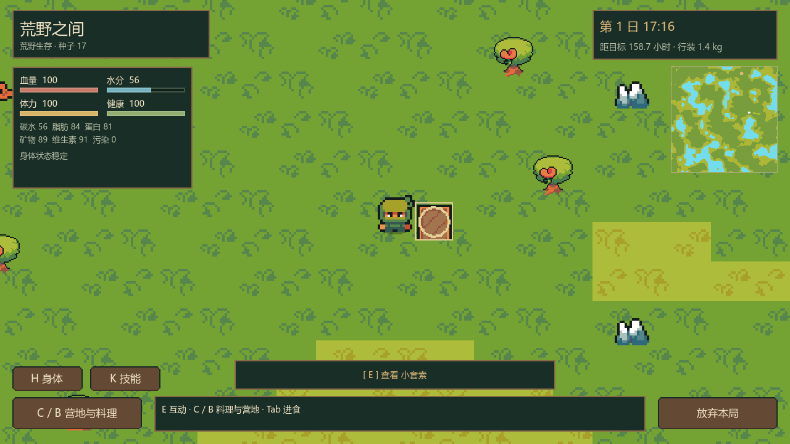
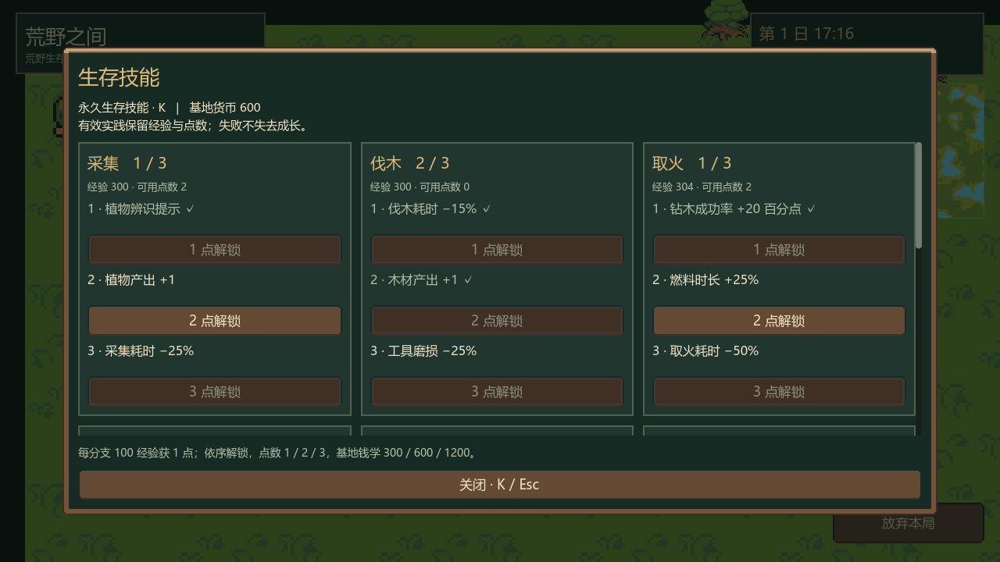
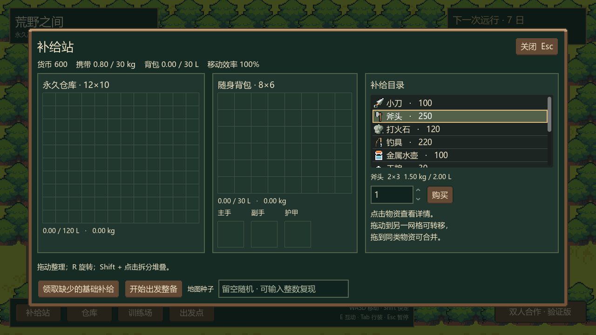
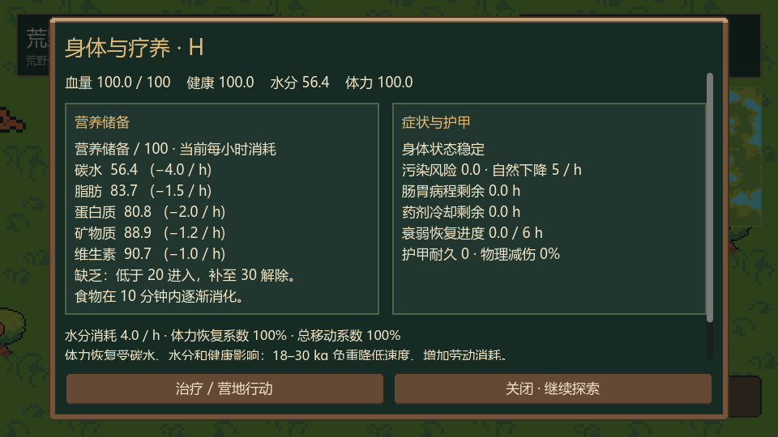
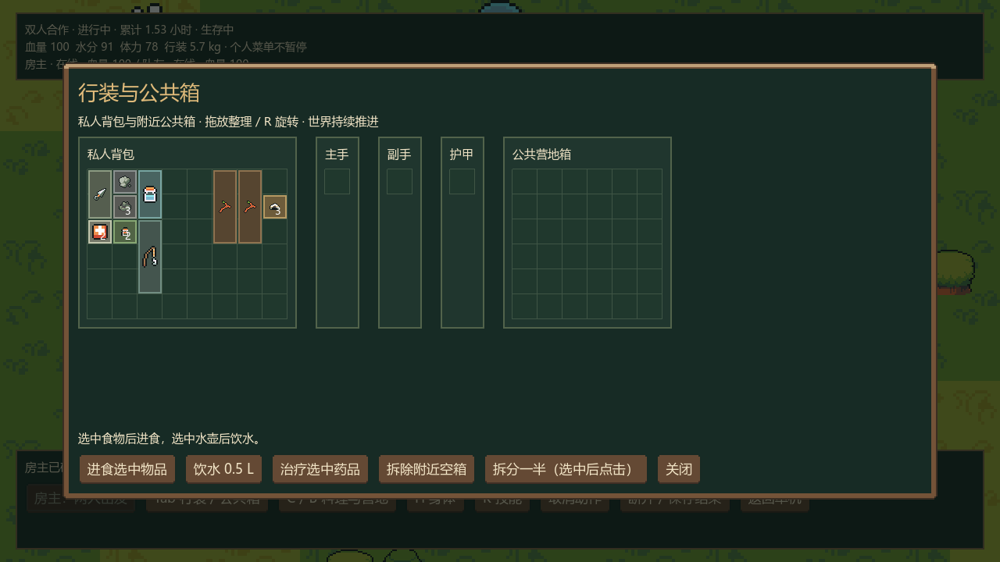
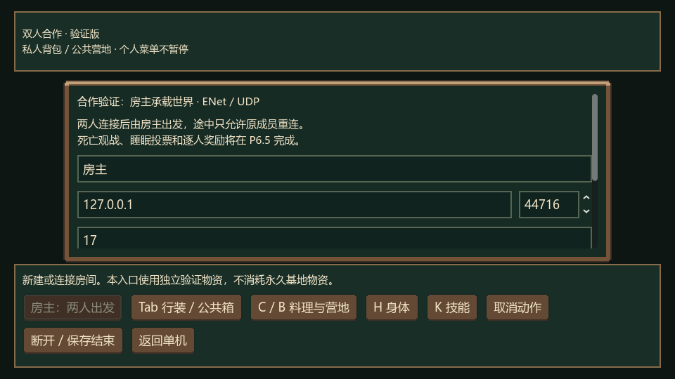

# UI 样式与布局改版

日期：2026-10-14。基于已验收 P0–P5 更新表现层，采用 Ninja Adventure 木质 UI 与森林营地色板。

## 已实现

- 棕木九宫格边框、森林绿内衬、米白正文与金色标题；按钮区分普通、悬停、按下和禁用状态，保留中文系统字体。
- 荒野 HUD：左侧血量 / 水分 / 体力 / 健康四条指标，营养与症状附在下方；右侧时间 / 目标与地图概览；底部集中互动、身体、技能、营地和返回入口。执行动作时显示进度与取消按钮。
- 库存：仓库、背包、装备和物品详情分区；基地小窗口采用较小格子，超出内容可滚动，商品使用原包图标。窗口重建保留正在输入的地图种子。
- 技能：九分支改为独立卡片。面板宽度 ≥1050 为三列，700–1049 为两列，更窄为一列；27 节点仍按原规则显示学习 / 解锁条件，滚动正文保留关闭按钮。
- 身体：营养与症状 / 护甲分卡片，长说明进入滚动区。营地行动按资源与饮水、照料与休息、建设与火源、维护与收取、料理与制作分类，动作名和成本分行。
- 单机 / 合作共用菜单遮罩，遮罩拦截背景鼠标；单机菜单继续暂停，合作菜单继续模拟。合作大厅可滚动，小窗口底部工具栏分两行，私人行装 / 装备 / 公共箱独立分区。
- 逻辑窗口边界验证覆盖 **960×540、1280×720、1600×900**。游戏仍采用原来的 `canvas_items` 缩放，最小窗口为 960×540。

## 模块与素材

| 模块 | 职责 |
| --- | --- |
| `WildUiTheme` | 共享色板、字体与控件状态；每个组合根创建独立 Theme |
| `WildUiLayout` | 面板居中 / 尺寸与遮罩层级；不决定暂停 |
| `WildVitalHud` | 从个人身体快照绘制指标；不模拟身体 |
| 既有面板与组合根 | 布局、滚动、输入意图；仍通过原会话提交业务操作 |

五张 PNG 源自官方包 `Ui/Theme/Theme Wood/`，适配配色并最近邻放大两倍，见 [UI 来源清单](../assets/ninja_adventure/ui/manifest.json) 与 [素材说明 / CC0](../assets/ninja_adventure/README.md)。可用 `tools/prepare_ninja_ui.py` 重建，运行游戏无需下载缓存。原人物、地形、资源差分与动画继续使用 Ninja Adventure。

本次没有新增玩法、改变数值、档案结构或网络协议。P6 / P6.5 待办仍按原阶段计划执行。

## 验证

| 检查 | 通过 / 失败 |
| --- | --- |
| UI 尺寸、正文空间、页脚、输入保留、单机暂停 / 合作不暂停 | 124 / 0 |
| P5 技能 / 捕鱼 / 陷阱真实 UI 回归 | 33 / 0 |
| P4 身体 / 治疗 UI 回归 | 16 / 0 |
| P3.5 实际合作组合根与回执 UI 回归 | 22 / 0 |
| Ninja 素材与动画定向回归 | 41 / 0 |
| P0 / P1 基地与库存回归 | 34 / 0、98 / 0 |
| P3 身体 / 动作 / 保存 / 结算回归 | 119 / 0 |

合计 **487 项通过，0 失败**。P3 自动策略在五个种子上完成 168 小时。所有验证使用随机 `.godot/verification/` 档案，合作只绑定回环。Godot MCP / Compatibility 的实际图形预览检查单机、合作与 960×540 小窗口，调试输出 `errors: []`。

受限终端导入仍有 `user://` 编辑器快照目录提示；各检查退出码 0，没有 GDScript 解析 / 执行错误。此次没有重复运行全套双进程网络故障注入；合作界面复用实际回环房主和显示队友夹具，不能视为新一轮完整多人验收。

```powershell
.\tools\verify_ui.ps1
.\tools\verify_ninja_art.ps1
.\tools\verify_p0.ps1
.\tools\verify_p1.ps1
.\tools\verify_p3.ps1
```

图形预览：Godot MCP 运行 `tests/ui_preview.tscn`、`tests/ui_coop_preview.tscn`。复用阶段测试的隔离夹具，另存 `ui-*.png`，保留旧阶段报告截图。

## 实际游戏预览












