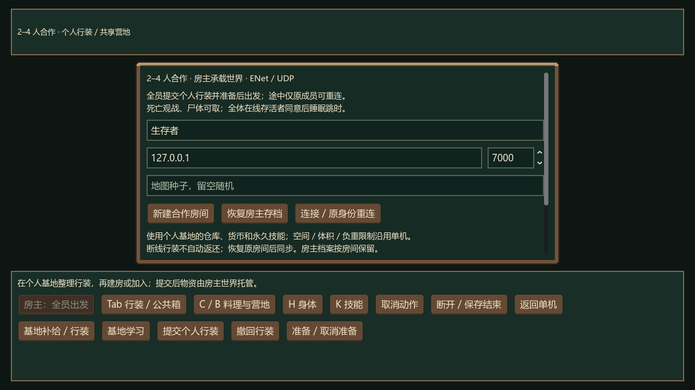
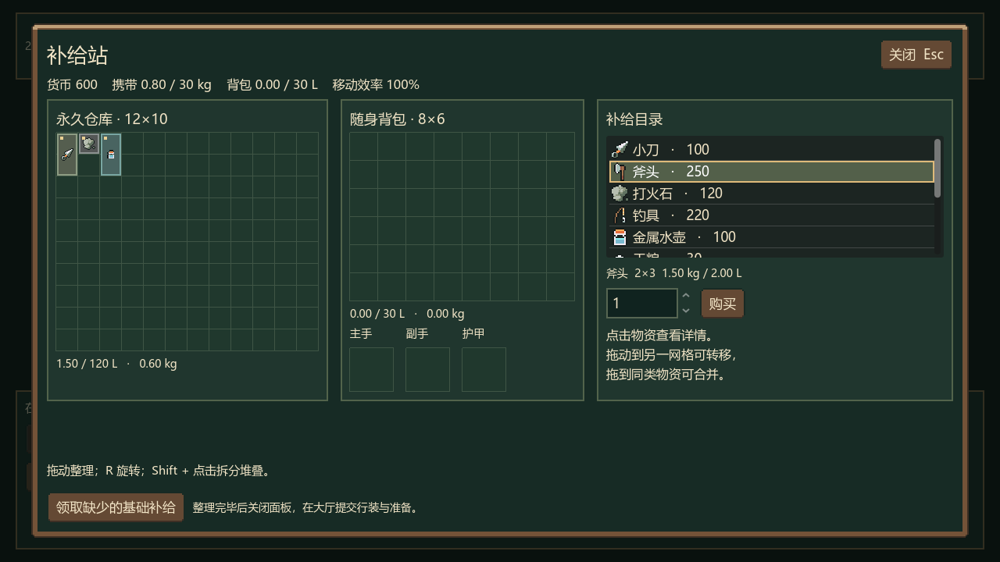
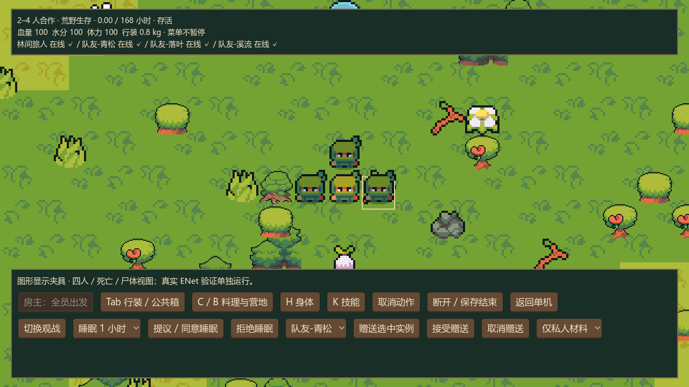
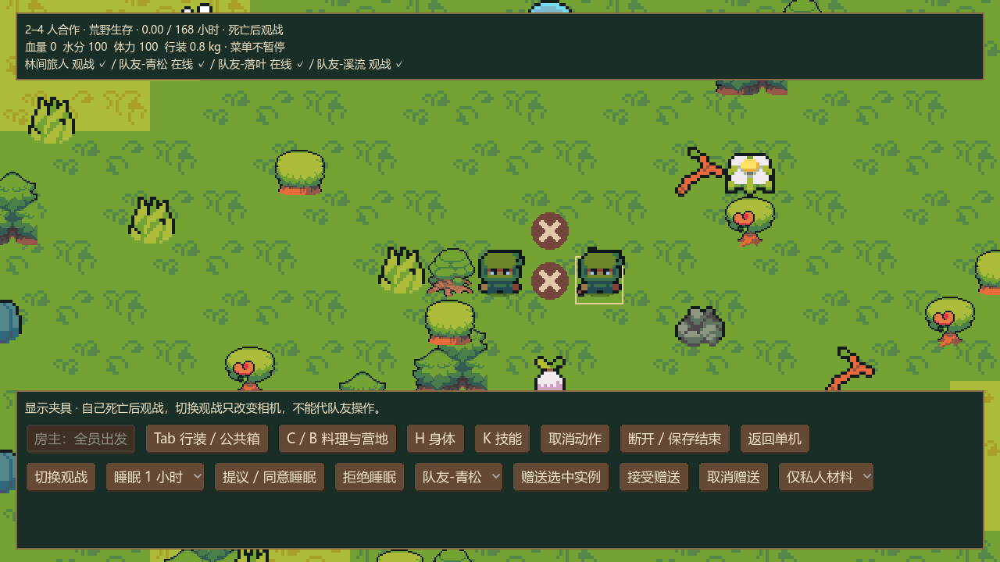

# P6.5：完整 2–4 人合作生命周期

更新：2026-10-15。状态：P6.5 已完成并通过本轮自动验收，下一阶段 P7。设计版本 0.2；网络协议 3，个人合作子版本 / 世界生命周期子版本均为 1。

## 本轮交付

基地的「2–4 人合作」进入 `scenes/coop_full.tscn`。个人基地与单机使用同一身份、仓库、货币和永久技能；原 `scenes/coop.tscn` 保留为独立双人验证入口，不混读完整合作世界。

实际流程：基地采购 / 整理 / 学习 → 建房或加入 → 提交个人行装 → 全员准备 → 房主出发 → 全员校验并加载房主地图 → 共享世界生存 → 逐人结算 → 返回个人基地。大厅取消或加载屏障解除前取消，退回原始行装；已经开始生存的房主退出只保存并结束连接，不提前成功结算。

同一安全出生区使用不同可通行格，不增加个人背包 / 升数 / 负重上限，不设初始件数限制。人数锁定后，植物 / 鱼 / 材料与既有动物 / 危险应用设计倍率；掉线和死亡不降低难度。个人探索和活动奖励分别统计，存活者独立获得基础 600 与本人探索 / 活动奖励；死者没有成功奖励，保留已获技能成长。

死亡中断动作并将随身 / 装备实例转入唯一尸体，原角色不复活；尸体只允许附近存活队友取出。自己死亡后隐藏人物、相机跟随存活队友，可切换观战；操作身份始终是自己。全体留存角色死亡则失败；到期同刻先处理身体与死亡，再决定存活者奖励。

赠送由发送者选中一个完整实例、指定队友发起，接收者看到物品 / 数量并明确接受；房主再次核对双方状态、距离、容量 / 重量后原子转移。待确认期间锁定发送者行装，取消 / 断线 / 死亡释放赠送。公共材料可在工具栏明确选择附近箱子，私人材料优先，剩余数量才从该箱预留；多人动作不能重复预留，转移不能拿走预留实例，取消不消耗材料。

合作菜单不暂停。睡眠采用单调现实钟的 30 秒提案、同一时长、全体在线存活者同意；低帧率和物理 delta 上限不延长期限，晚到投票不能复活超时共识。各在线存活角色都须靠近营地。离线存活角色也参与安全判断，血量 / 水分 ≤20、出血、附近危险动物或伤害会中断全体睡眠。跳时每次最多推进一分钟，共用身体 / 病程 / 燃料 / 腐坏 / 动物 / 陷阱模拟，不能另行劳动或转移；成员断线、重连或死亡取消旧共识。尸体物品也继续腐坏。

## 个人与世界存档

个人行装先在个人档案建立不可用租约，再提交房主；私人仓库不发送到世界。租约未关闭时禁止在其他任务重复使用行装或修改永久成长。房主接收并持久化后才允许准备；断线不自动退还。原成员恢复后继续核对同一租约，不能再次导入一套物资。

房主在同一世界事务中保存收据 outbox 与权威结果。个人收据包含房间、任务、玩家、租约、单调序号、累计技能和终态物资 / 奖励；个人写盘成功后才发送 ACK，收到房主成功确认才记作已确认。ACK 途中断线可重发；旧收据不倒退成长，终态重发不重复奖励或物资。满仓物资沿用持久待领取区；公共箱与设施不自动分配返仓，尸体物品归实际取走并带回的存活者。

未送达房主的 offer 也可由原成员在已取消房间重新提交，取得明确释放收据。房间按独立文件保留，另开房间不会覆盖离线成员尚未领取的旧结果。名单开始后锁定，只允许原成员凭据重连；身体、库存、冷却和随机序列沿用原记录。

正式个人路径仍为 `user://profile_identity.cfg` / `user://base_state.json`。完整房间位于 `user://coop_rooms/`，大厅可选择旧房间恢复；验证房间仍使用原独立路径。单机和合作切换只交接同一身份 / 存档位置，显式测试路径也不会因换场景回退到正式路径。

`WildDurableStateStore` 为个人和完整世界保存完整 JSON 日志、提交头和主档。日志先写，再原子替换摘要头，最后更新主档；摘要计算实际 JSON 文本字节，避免浮点 JSON 往返的末位差异。提交头成功后即使主档替换失败也可从同一提交的完整日志恢复；再次写入前先修复上一完整主档，连续失败不能覆盖唯一恢复来源。不会因主档损坏回退到可能复制旧物资的较早 `.bak`。提交头缺失但存在日志、或找不到摘要相符的完整记录时停止恢复并保留文件。旧档未建立提交日志前仍兼容原主档 / 备份恢复。

总存档版本仍为 1，新增 `cooperation.version=1`、`lifecycle.version=1`、逐人探索、资源人数和尸体字段；未知未来子版本拒绝覆盖。恢复额外检查租约、连续交付链、终态库存、尸体归属与实例唯一性。协议摘要中的小数使用六位十进制规范化，领域实际数值不因此改写；文件完整性校验使用原样文本 SHA-256。

## 模块边界

| 模块 | 职责 |
| --- | --- |
| `full_coop_service.gd` | 完整合作应用事务、阶段限制、统一模拟与提交；复用原房主业务 |
| `coop_profile_rules.gd` | 个人租约、单调收据、技能 / 奖励 / 返仓与恢复校验 |
| `coop_profile_link.gd` | 个人写盘、房主 ACK 与断线重试桥接 |
| `coop_lifecycle.gd` / `coop_deliveries.gd` | 全员投放、死亡 / 尸体、逐人结算、持久 outbox |
| `coop_sleep.gd` / `coop_gifts.gd` / `coop_materials.gd` | 投票 / 跳时、确认赠送、共享数量预留 |
| `coop_world_rules.gd` | 一次性资源人数倍率与独立随机流 |
| `durable_state_store.gd` / `canonical_data.gd` | 完整提交日志、实际文本校验与跨端摘要 |
| `full_coop_codec.gd` | 完整生命周期、尸体、交付链与跨实例恢复校验 |
| `network_compatibility.gd` / `enet_room.gd` | 版本检查、ENet 身份绑定、快照与控制 / 输入分流 |
| `coop_replica_session.gd` | 本地移动预测、输入确认后的重放 / 纠正、远端插值 |
| `full_coop_main.gd` / `wilderness_world.gd` | 实际个人整备、大厅、赠送 / 材料 / 睡眠入口、尸体 / 观战显示 |

UI 只提交意图；客户端不提供伤害值或写共享状态。网络协议 3 使用可靠世界快照通道、独立可靠结果 / 结束通道，以及不可靠有序位置 / 输入通道。世界快照以基础 Variant 编码后 DEFLATE 压缩，解压硬上限 8 MiB，不反序列化对象，避免四人 / 房间恢复时大快照积压。请求重发只补收据，待发送状态快照合并，地图只给尚未确认加载的队员。可靠状态版本与位置帧分别判断，较新的位置帧不能阻止随后到达的库存 / 生命周期状态，较旧快照也不倒退位置与即时身体值。四人位置帧采用紧凑数组，保持 1200 字节以内测试预算，极低正血量不会量化为死亡。

Ninja Adventure 美术和动画保留；新增尸体为简单标记。1280×720 图形预览覆盖大厅、个人补给、四人、尸体和观战；960×540 检查工具栏换行可操作、大厅不覆盖工具栏。图形场景是明确显示夹具，真实通信另由四进程检查。

## 验证与证据

最终命令为 `tools/verify_p65.ps1`，图形场景为 `tests/p65_preview.tscn`。所有网络案例仅绑定 `127.0.0.1` 随机 UDP 端口，个人身份 / 个人档 / 世界档均在随机 `.godot/verification/` 目录。

| 验证 | 通过 | 主要覆盖 |
| --- | ---: | --- |
| P6.5 领域 | 308 | 2 / 3 / 4 人、租约、加载取消、迟到 offer 释放、公共材料 / 无悬空依赖、赠送回滚、现实钟睡眠 / 伤害 / 重连、尸体、成长 / 满仓 / 去重、完整日志失败恢复、四个完整稳定 ID 的二进制位置载荷 |
| P6.5 实际 UI | 48 | 真实个人整备 / 技能、地图校验、观战、菜单策略、预测 / 纠正、跨通道顺序、小窗口、同档案场景往返、有界快照压缩 / 恢复、极低正血量不误判死亡 |
| 正常四进程 ENet | 149 | 43 房主 + 35 / 34 / 37 三个客户端；实际装载 / 准备 / 加载、公共箱三方争抢、赠送、有效采集的个人技能交付、全员睡眠 / 伤害中断、离线死亡 / 重连 / 尸体、到期逐人写盘 / 重发 |
| 故障四进程 ENet | 179 | 19 初始房主 + 32 恢复房主 + 43 / 40 / 45 三个客户端；每向 50 ms、每百报文丢一包，定向丢库存请求；房主进程未执行结束保存流程即退出后，由新进程恢复，原三人重连，永久成长 / 行装不复制 |
| P6 / P5 / P4 / P3.5 回归 | 1047 | 分别 229 / 391 / 201 / 226 项，含领域、真实 UI 与正常 / 故障双进程网络，按最终协议 3 顺序重跑 |
| 单机 / 地图 / 库存 / 会话 / 美术回归 | 658 | P3 119、P2 366、P1 98、P0 34、Ninja 41；P2 本轮重跑百种子，0 回退，最大生成 981.36 ms |
| 既有布局专项 | 124 | 独立逻辑视口的菜单边界、滚动正文、输入保留、工具栏与合作模式策略 |

P6.5 新增 **684 项**通过，既有阶段回归 **1705 项**及布局专项 **124 项**通过；不将同一套 UI 的重复执行再次累计。最终界面夹具完整快照由 **413992 字节**压缩为 **39721 字节**，约减少 90.4%；这是具体夹具的数据量，不作为最终帧率 / 吞吐承诺。四人故障恢复后在原定现实 30 秒共识期限内完成睡眠投票与伤害唤醒，没有放宽期限。

五个单机种子 `17 / 18 / 7936 / 15855 / 31693` 均完成 168 小时、最终血量 100，水分分别为 `86.5 / 81.9 / 92.3 / 83.5 / 95.1`。策略继续使用默认 600 资金购买 17 干粮 / 2 绷带，优先使用已有料理原料；没有放宽目标时间、伤害或行动费用。

四进程到期测试布置合法的最后一分钟，再由共用模拟触发结算，不声称四人按正常速度跑满七日。房主恢复案例是在已提交世界后跳过 `end_room` 退出，再以新进程恢复，非断电实测；写盘阶段失败另由完整日志故障注入验证。四人真实网络是同机回环，不代替跨设备 LAN / 公网可达性、人工平衡试玩、150 ms / 5% 故障或 P8 性能目标。

收尾检查中，一次新增的场景切换 UI 测试把路径元数据挂在 Window 而非 SceneTree，导致该次测试读取了正式身份 / 基地档案；未执行基地变更，主档 / 备份长度与修改时间保持 `25902 / 228157` 字节、`2026-10-13 16:46:46`，没有新增正式提交日志。已改为 SceneTree 交接，同时显式注入随机测试路径并断言隔离；最终版本按此修正重跑。此处不把“未修改正式档案”写成“从未读取”。

本轮还修复 JSON 浮点摘要误报、重发广播放大、跨通道状态顺序、ACK 未确认就缓存、全体睡眠重连 / 死亡中断，以及大快照积压的问题。现实钟测试暴露原未压缩状态在故障恢复时积压，现以有界压缩和控制分流解决；旧无渲染进程增加 60 FPS 上限、默认连接等待为有界 30 秒，保留全部业务断言。日志原始文本校验与端到端收据分别验证，不能用摘要代替实际状态。

Godot MCP 最终图形运行输出 `errors: []`，实际设备为 Intel Iris Xe / OpenGL 3.3 Compatibility；记录见 `docs/evidence/p65-godot-mcp.json`。已核对个人补给 / 行装、大厅、四人显示、尸体和观战图；这些显示夹具不充当实际通信证据。

证据归档于 `docs/evidence/p65-*`，包括各端日志 / 结果、阶段回归和正式档案元数据审计；预览图于 `docs/previews/p65-*.png`。下一阶段 P7：内容整合、经济与可用性；四人吞吐 / 保存阻塞、更多网络条件及导出仍按 P8 验收。

