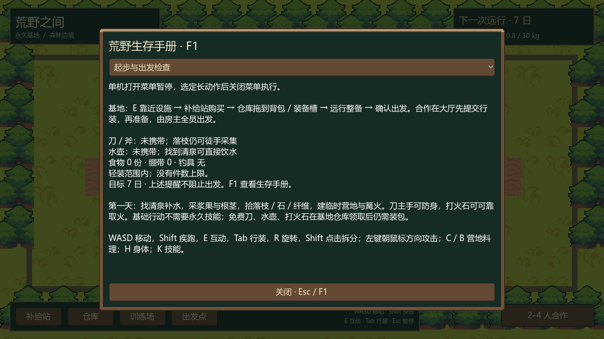
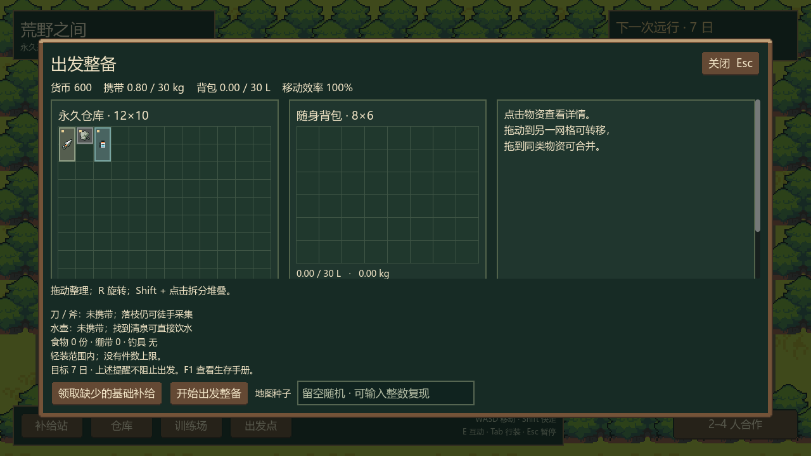
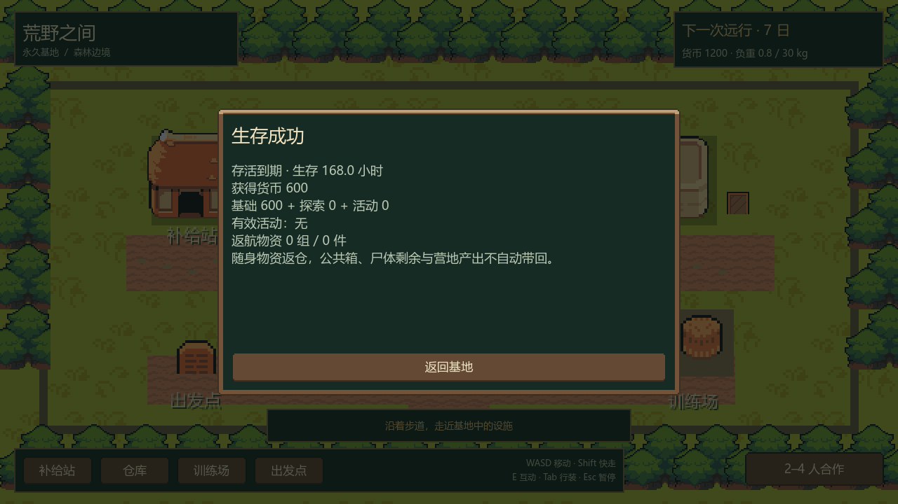

# P7：内容、经济与可用性整合

更新：2026-10-15。设计基线 0.2，Godot 4.7.2 / Compatibility。P7 在 P0–P6.5 已实现领域规则上整合首版内容，后续 P8 执行性能、跨设备与导出验收。

## 玩家可见变化

- **F1 生存手册**：单机基地 / 荒野和合作大厅 / 荒野都能打开。包含起步、三条食物路线、全部配方、九类技能、采购行装、身体治疗、合作保存与最近任务摘要。长内容滚动，支持 960×540；单机暂停，合作阅读时世界继续。
- **出发检查**：整备点和合作基地面板显示实际随身工具、水壶、食物、绷带、钓具和轻装状态。仓库里的物品不当作已经携带。提醒不额外阻止出发，没有恢复五件限制。
- **返航倒计时**：单机与完整合作都显示剩余日 / 时 / 分，不会提前显示负值或把尚未到期的一秒当作胜利。
- **任务明细**：基础、个人探索、有效活动奖励、活动种类、返航组数 / 件数，以及待领取提示。单机结果使用固定滚动区域，避免长文字撑出窗口；合作个人收据落盘后自动打开一次，可 F1 重新查看。
- **交互反馈**：修正合作睡眠仍标作“后续开放”的旧提示；补全体力、行装租约、公共材料、房间类型等中文原因。

已有首批内容为 25 种物品、9 种食物、9 分支 / 27 技能节点、17 项基础和高级配方，以及煮水、取火、燃料、休息、捕鱼、陷阱维护、拆除等动作。手册从当前物品 / 配方 / 技能 Resource 生成数值，不另维护一套平衡表。本阶段没有为凑数量添加新素材或配方。

## 路线与经济实测

实验使用 `tests/p7_checks.gd` 的真实开始 / 完成、费用、料理、进食和消化路径。初始营养均为 50，无任何已解锁技能。采集与近战夹具为确定性，各执行一次；捕鱼使用 100 条独立固定随机流，直到每条得到一份鱼，共 164 次捕鱼。所有熟食实际完成消化，污染保持 0。

| 路线 | 从开始取食到消化完成，游戏分钟 | 水分平均消耗 | 单份营养：糖 / 脂 / 蛋白 / 矿物 / 维生素 |
| --- | ---: | ---: | --- |
| 采集根茎 → 烤根茎 | 26.0 | 2.23 | 30 / 1 / 3 / 8 / 6 |
| 捕鱼 → 熟鱼 | 70.2 | 6.65 | 0 / 15 / 30 / 10 / 2 |
| 小刀两次命中兔 → 熟肉 | 22.4 | 1.83 | 0 / 15 / 30 / 10 / 2 |

这是**动作成本控制实验**：预置可达目标、燃烧篝火和捕鱼所需饵料，不计探索、追逐、拾饵、建火和补燃料。兔确实移动，第二次命中前由夹具重新贴近，不把夹具定位当作正常追猎。因此不能据 22.4 分钟声称狩猎在整局一定最快。采根茎一次得到 3 份，本表只食用其中一份，其余原料仍保留。捕鱼失败真实扣饵、磨损钓具和耗时，没有强行改成功随机数。

| 首局采购选择 | 消费 | 剩余资金 | 装包重量 / 体积 |
| --- | ---: | ---: | --- |
| 17 干粮、2 绷带 | 590 | 10 | 5.75 kg / 7.65 L |
| 钓具、10 干粮、2 绷带 | 600 | 0 | 4.60 kg / 6.00 L |
| 一级培训、7 干粮、2 绷带 | 590 | 10 | 3.25 kg / 4.15 L |

三套都实际装包校验，包含免费刀 / 打火石 / 空水壶和背包自重，不含饮水重量。营养路线互补，不能只靠鱼肉补糖，也不能指望根茎提供充足脂肪。保留基础奖励 600、探索最多 100、九类活动各 10，以及培训 300 / 600 / 1200；目前证据不足以支持提高价格或削弱某条路线。首局可选择补给、钓具或培训，培训不是开局必要条件。

零货币验证从实际基地服务领取免费补给、逐件装包并生成世界，再通过采集落枝 / 纤维 / 石、建营地 / 篝火、免费打火石取火验证无技能门槛。这个门槛检查在隔离世界移除危险动物，不冒充零货币正常七日挑战。默认配置的七日自动策略与五个种子证据仍按 P3 执行。

## 规则与持久化

`WildExpeditionReport` 是单机与房主共用的只读结算统计。返航前冻结明细，再由原有候选事务同时写入库存、奖励和收据；展示代码不发钱。合作统计读取执行者活动与个人探索，不把队友贡献算给自己。死者无成功奖励，尸体、公共箱和未领取产出不会自动归入随身返仓统计。

个人档案与合作交付新增可选 `report` 字段。旧档 / 旧事件没有明细时继续读取，只显示已有总奖励，不伪造历史数据；新字段校验奖励之和、探索比例、唯一活动和返还数量。网络内容指纹包含新脚本，旧工程不能绕过内容版本检查与新工程联机。

沿用 P6.5 完整提交日志、同任务收据去重、满仓待领取区和原身份重连。长动作在目标时刻或跨过目标时刻结束时不再交付产出、也不扣未完成材料；同刻死亡优先于成功。结算写盘失败时奖励和明细都不提交，重试后只应用一次。场景重入保留已结算结果。

## 需求入口核对

| 需求 | 操作入口与反馈 |
| --- | --- |
| 采购、重量 / 体积、网格携带 | 基地补给站 / 仓库，Tab；格子、体积、负重与拒绝原因 |
| 随机投放与七日目标 | 基地出发点；可指定种子、整备检查、地图与倒计时 |
| 血量、护甲、营养、健康、饮水、体力 | 状态条、H 身体；症状、耐久、消化与治疗提示 |
| 实践 / 基地学习、技能门槛 | K；分支经验、点数、费用、节点效果与拒绝原因 |
| 采摘、伐木、捕鱼、狩猎 | E 资源 / 鱼点、主手刀斧弓左键；动作时间、磨损、掉落、失败提示 |
| 营地升级、取火、陷阱、疗养、料理 | C / B 与 E 对应设施；配方、材料、技能、进度与取消 |
| 失败、成功、返仓、奖励 | 放弃确认、死亡 / 到期自动结算、结果面板、F1 最近任务摘要 |
| 四人合作与共享设施 | 大厅准备 / 加载、公共箱、赠送确认、睡眠投票、观战 / 尸体、重连与逐人摘要 |
| 满仓、零资金与异常恢复 | 基地领取返航物资 / 免费基础补给、保存失败冻结 / 重试、原房间恢复 |

## 验证与范围

P7 验证入口：`tools/verify_p7.ps1`。新增 **315 项**，其中领域整合 265、实际 UI 50；包含三条食物路线、实际装包、零资金基础建造、目标时刻动作、同刻死亡、结算写盘失败 / 重试、旧档兼容、合作逐人明细 / 重发和 960×540 布局。

| 本轮回归 | 通过项 |
| --- | ---: |
| P6.5 完整领域 / 实际 UI | 308 / 49 |
| P6.5 正常四进程 / 100 ms RTT 与应用层 1% 丢包、房主进程恢复 | 149 / 179 |
| P3 单机整合与五个七日自动策略 | 119 |
| 通用 UI 布局 | 127 |
| P5 / P4 / P3.5 实际 UI | 33 / 16 / 22 |
| Ninja 美术 / 动画 | 41 |
| P6 战斗领域 / P5 技能领域 | 119 / 220 |

回归共 **1382 项**，Ninja 专用脚本与 UI 套件重复执行的 41 项只统计一次。四进程正常用例为 `.godot/verification/p65-ad65b031fb7442b7aed7aaf4453f2ac1`，故障用例为 `p65-6777dbcb45e54dd4bf251a1921aed7a9`；故障合计包含重启前房主 19 项，不遗漏或重复计数。五个默认配置七日种子为 17、18、7936、15855、31693，全部 168 小时 / HP 100，结束水分分别为 86.5、81.9、92.3、83.5、95.1。它们推进完整领域时间，不等同于等待墙钟时间的人工试玩。

证据归档在 `docs/evidence/p7-*`。路线原始数据见 [p7-routes.json](evidence/p7-routes.json)，图形引擎 / 渲染器及无错误输出见 [p7-godot-mcp.json](evidence/p7-godot-mcp.json)。五张预览均已实际查看，结果面板长文本撑出视口和整数除法警告在最终预览前修复。所有测试强制随机工作区身份 / 基地，不打开正式档案；正式基地与备份的大小 / 修改时刻核对见 [p7-formal-files.json](evidence/p7-formal-files.json)。

本阶段交付可串联首版候选版本。真实跨设备 LAN、人工合作七日、150 ms / 5% 网络目标、1080p 性能与 Windows 导出仍属于 P8；回环验证和提前设置任务时刻的结算夹具不能替代这些验收。

预览为隔离场景生成，不能代表正式档案进度：

